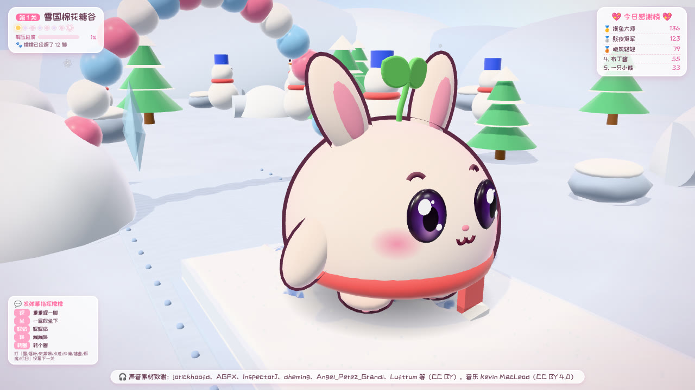
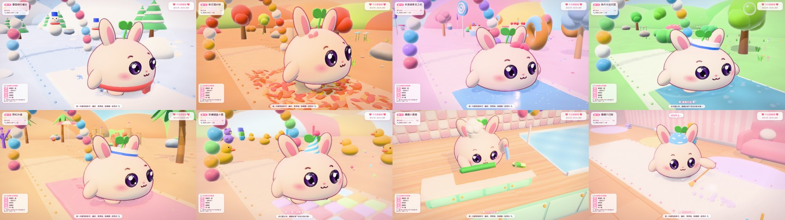

# 🐾 糯糯的 ASMR 奇遇（解压闯关版 v3）—— 抖音直播 · 真实 ASMR × 萌宠 × 解压闯关

原创 3D 萌宠「糯糯」自己闯过一关又一关：踩新鲜的粉雪、一屁股坐进史莱姆、跳过蘑菇跳跳石、从冰雪滑梯上滑下来扑进雪堆、在果冻蹦床上连跳三下翻跟头……
还会进厨房切菜、打蛋、煎松饼，给房间来一次大扫除。每一脚都会留下真实的痕迹，并播放**真实录制**的 ASMR 声音；镜头以**正面**为主，一直看得到它可爱的小脸。
有人送礼物，糯糯会停下来**随机跳一支舞**并显示「**谢谢 XX 老板！**」；观众发弹幕可以**指挥糯糯**、**投票下一关**。开播后挂着就行，不需要人管。



## ✨ 亮点

- **更解压、更好玩的闯关**：解压站之间穿插 **跳跳石、蹦床（三连跳 + 空翻）、滑滑梯（果冻垫弹上平台 → 挥手 → 滑下 → 扑进球池/雪堆/落叶堆）、气球/雨伞飘飘、摇摇桥**；节奏按 3D 马里奥的"起承转合"编排，参考 Fall Guys 的软弹障碍设计。
- **8 个世界、多元场景**：雪国、落叶林、史莱姆工坊、雨天花园、彩虹沙滩、软糖键盘小屋，以及新的 **糯糯小厨房**（切蔬菜 → 打蛋搅面糊 → 煎松饼翻面 → 踩奶揉面团 → 裱花蛋糕）和 **糯糯大扫除**（扫灰尘 → 擦地板 → 叠衣服 → 收纳玩具 → 泡泡浴盆），参考 Cooking Mama、PowerWash Simulator、Unpacking 的即时反馈。
- **看得到可爱的正脸**：镜头在糯糯前方后退跟拍（3/4 正面），走 S 形路线时身体会稍微朝镜头偏（影视里的"对着镜头演"），不会拍成侧面；踩奶、坐下、跳舞时转身面向观众；回头看脚印用反打镜头；滑梯在底部迎着拍，蹦床低机位仰拍，任务站像美食节目一样在操作台正前方拍。镜头距离按横屏 / 竖屏视角自动计算，从耳朵尖到小脚都完整入画。
- **更可爱的画风**：水汪汪的彩色大眼睛（双高光）、会动的小眉毛、粉色肉垫、暖色主光 + 逆光轮廓光、糖果色远山与云朵。
- **全部是真实录音**：42 种声音、220 多个录音变体（CC0 / CC BY / Pixabay / MIT，作者见 [`web/sounds/CREDITS.md`](web/sounds/CREDITS.md)）。**已删除有尖锐段落的舞曲 Fluffing a Duck 和鸟鸣/虫鸣环境声**；每个录音都做了"刺耳度体检"，自检会拒绝任何刺耳素材。
- **声画同步**：声音从录音的起音处开始放，正好落在脚着地、刀落到砧板、锅铲挑起松饼的那一帧；低延迟输出；舞步直接读音乐播放时钟，长时间不错拍。
- **礼物答谢**：18 支舞蹈随机挑选 + 真实可爱舞曲；中礼物把老板名字踩进雪地，大礼物「巨人糯糯」，超级礼物「连锁解压」；连击合并、小礼物刷屏自动攒着一起谢；今日感谢榜。
- **弹幕互动**：「踩」「坐」「踩奶」「跳」「转圈」让糯糯照做，说世界名字（如"去厨房""想看打扫"）就是投票选下一关。
- **7×24 无人值守**：看门狗自动重启卡死/关闭的画面、监听断线自动重连、程序崩溃自动重启、定时释放内存、断线期间的礼物自动补发；每关结束彻底释放显存。
- **零依赖、一键启动**：双击 `启动糯糯.bat`，自动准备运行环境（便携 Node.js，SHA256 校验）。横屏、竖屏都支持。




## 🚀 快速开始（Windows）

1. 下载本项目（`Code → Download ZIP`）并解压到固定文件夹。
2. 双击 **`启动糯糯.bat`**。第一次会自动准备运行环境，随后自动打开**游戏窗口**和**控制台**。
3. 在控制台填写你的**直播间号或抖音号**，保存。
4. 抖音直播伴侣 → 添加素材 → **窗口** → 选「糯糯的ASMR奇遇」→ 开播。

不开播先看效果：双击 **`演示模式.bat`**（随机模拟礼物和弹幕），或在控制台点测试按钮。
关闭：双击 **`停止糯糯.bat`**。

👉 **详细教程（直播伴侣设置、横竖屏、玩法、礼物与弹幕规则、声音说明、挂机须知、故障排查、合规提醒）请看 [docs/使用手册.md](docs/使用手册.md)。**
👉 **v3 的设计思路与参考的成熟作品见 [docs/设计说明-v3.md](docs/设计说明-v3.md)。**

## 🧪 自检

```bash
node tools/selftest.mjs        # 47 项自检：协议解码、礼物去重、世界/闯关元素/任务站、导演 AI、弹幕、全部声音素材（授权、刺耳度、声画同步数据）、代码静态检查…
node tools/test-listener.mjs   # 用真实浏览器验证直播监听链路（模拟直播间，无需开播）
```

## 📁 目录

```
启动糯糯.bat / start.bat     一键启动（自动准备 Node.js、崩溃自动重启）
演示模式.bat / 停止糯糯.bat / 自检.bat
config.example.json          配置模板（带中文注释，首次运行复制为 config.json）
server/                      本地服务：静态页面、SSE 推送、看门狗、抖音监听（CDP）、BarrageGrab/演示数据源
web/                         游戏（three.js）：萌宠与道具、世界与闯关路线、解压站/任务站/闯关元素、镜头导演、导演 AI、真实录音播放引擎、界面；admin.html 控制台
web/sounds/                  打包好的真实录音、manifest.json（含体检数据）、CREDITS.md（素材署名）
assets/sounds/               放你自己的录音替换内置声音（可选，见使用手册第 11.4 节）
tools/                       自检、监听测试、声音素材下载与打包（开发者用）
docs/                        使用手册、设计说明与截图
```

## ⚠️ 提醒

请遵守抖音平台直播规范；平台对无人/挂机直播有管理要求，请自行评估。礼物与弹幕数据通过读取你自己直播间的公开信息获得，属于非官方方式，抖音改版可能导致失效（可切换到 BarrageGrab 备用方案）。CC BY 素材需要署名，游戏画面已自动显示致谢，请保留。详见使用手册第 15 节。

开源组件：three.js（MIT）、站酷快乐体（SIL OFL 1.1）；声音素材见 `web/sounds/CREDITS.md`；舞曲 Kevin MacLeod（incompetech.com，CC BY 4.0）。
