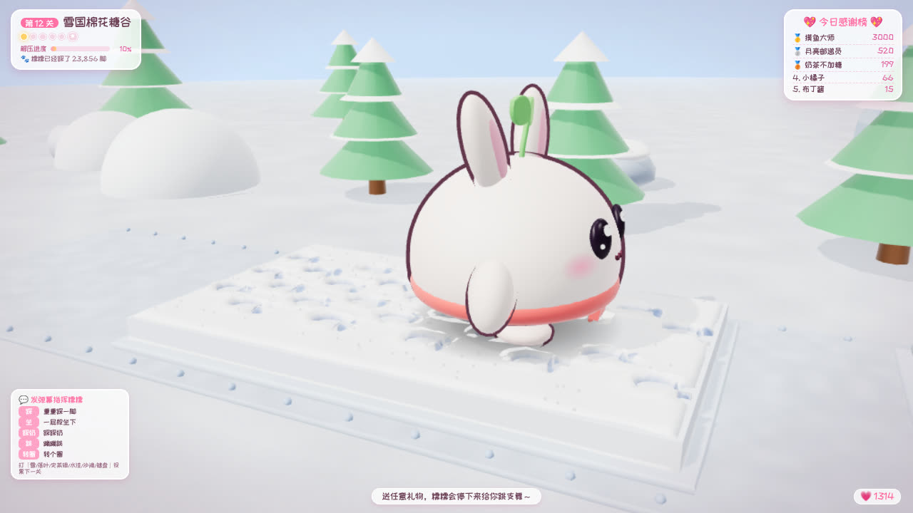
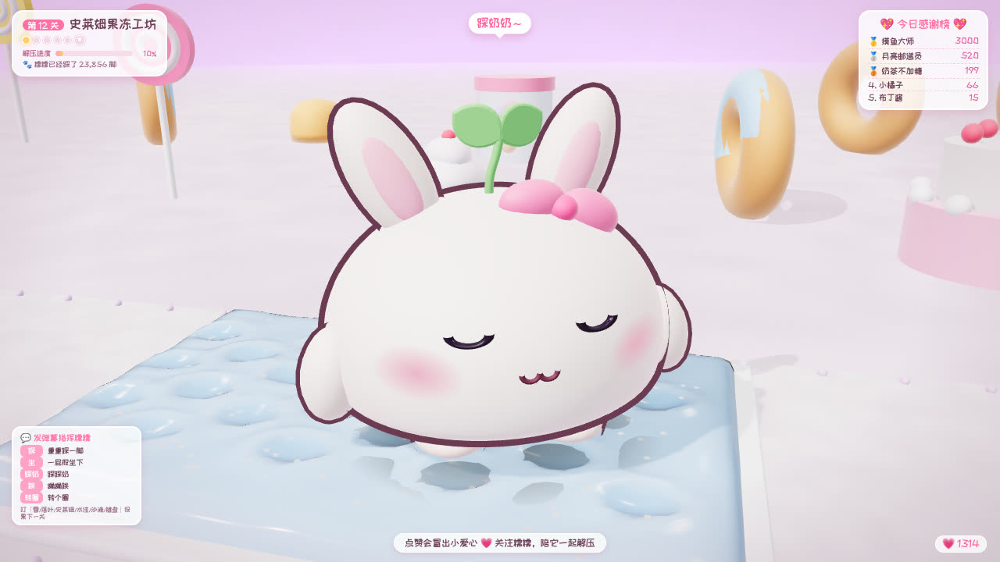
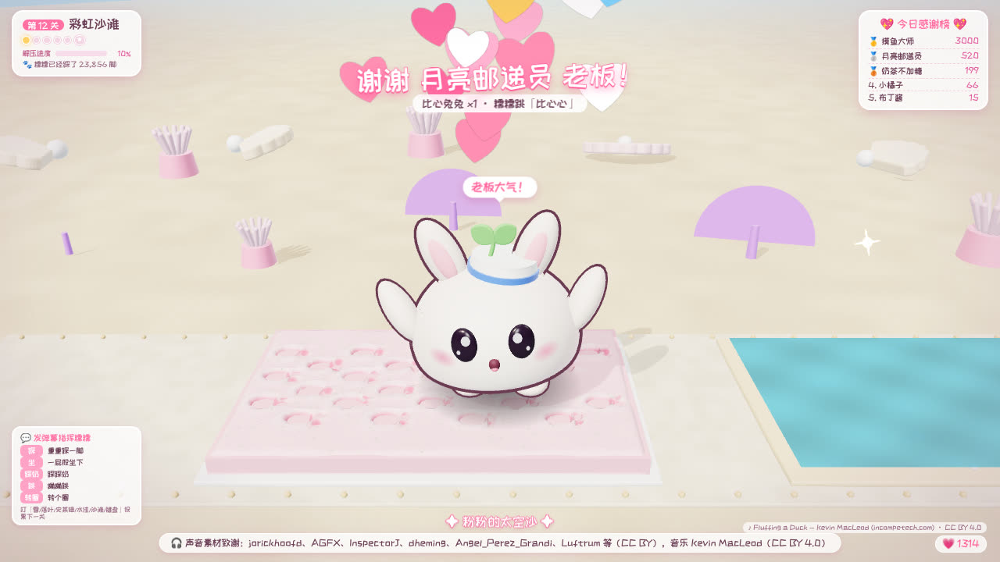
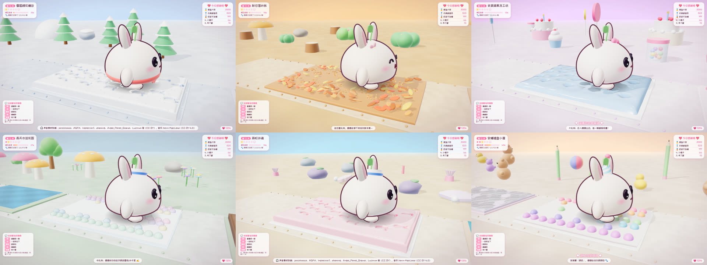
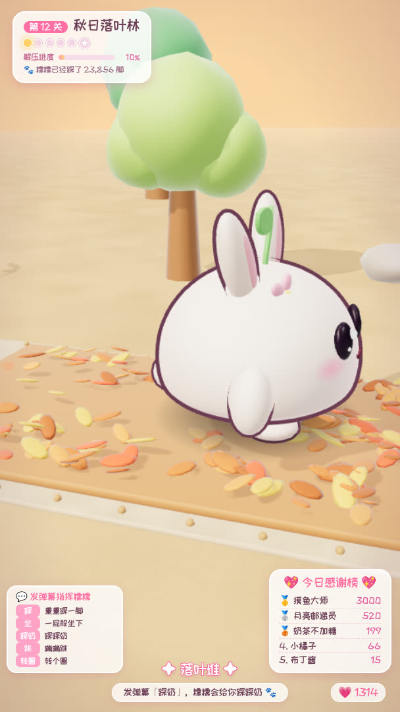

# 糯糯的 ASMR 奇遇（解压版）· 详细使用手册

> 一款为抖音直播打造的「真实 ASMR 录音 + 原创 3D 萌宠 + 解压闯关」挂机直播项目。
> 原创萌宠「糯糯」会自己走过一个又一个「解压站」：踩新鲜的粉雪、踩爆一片肥皂泡、一屁股坐进史莱姆、在太空沙上踩奶……
> 每一种材质都会留下真实的痕迹（脚印、凹坑、裂纹、被按下去的泡泡），并播放**真实录制**的 ASMR 声音。
> 有人送礼物，糯糯会停下来随机跳一支舞并显示「谢谢 XX 老板！」，然后继续解压。观众还可以发弹幕指挥糯糯、投票决定下一关。开播后挂着就行。

---

## 目录

1. [它能做什么](#1-它能做什么)
2. [电脑要求](#2-电脑要求)
3. [三步快速开始](#3-三步快速开始)
4. [找到你的直播间号](#4-找到你的直播间号)
5. [抖音直播伴侣设置（重点）](#5-抖音直播伴侣设置重点)
6. [长时间挂机须知](#6-长时间挂机须知)
7. [玩法：六个解压世界](#7-玩法六个解压世界)
8. [礼物互动规则](#8-礼物互动规则)
9. [弹幕互动与投票](#9-弹幕互动与投票)
10. [控制台使用说明](#10-控制台使用说明)
11. [ASMR 声音（全部是真实录音）](#11-asmr-声音全部是真实录音)
12. [自定义设置（config.json）](#12-自定义设置configjson)
13. [自检工具](#13-自检工具)
14. [常见问题与故障排查](#14-常见问题与故障排查)
15. [合规与风险提醒（务必阅读）](#15-合规与风险提醒务必阅读)
16. [技术原理（给想二次开发的人）](#16-技术原理给想二次开发的人)
17. [开源组件、素材与致谢](#17-开源组件素材与致谢)

---

## 1. 它能做什么

| 需求 | 实现方式 |
|---|---|
| ASMR + 萌宠 + 闯关 | 每一关是一条桌面微缩赛道：5 个「解压站」+ 1 个巨型终点解压物。糯糯一站一站地踩过去，进度条和站点小圆点一点点亮起来，终点玩个痛快后进入下一个世界 |
| 解压游戏（参考 ASMR Tippy Toe、Roblox Needoh Tower、Super Slime Simulator、Soap Cutting 等成熟爆款） | 每一脚都会留下**持续存在**的痕迹：太空沙/雪地上一串清晰的小脚印、史莱姆被压下去后慢慢流平、慢回弹面包被压扁再慢慢鼓回来、按压泡泡一颗颗凹下去、肥皂泡被踩破、冰面一步一道裂纹、落叶和雪球被踩扁成碎屑、水洼泛起涟漪；还有踩奶、一屁股坐下去、俯身按一按、划一道沟、重重跳踩、踮脚连按等特别动作 |
| 原创、可爱的 3D 萌宠 | 「糯糯」是一颗软糯的麻薯团子，兔猫耳朵，头顶小豆芽；程序化建模，带挤压拉伸、弹簧次级运动、眨眼、眯眼享受、脸红；每个世界有专属小配饰 |
| 声音要专业、不要合成音 | **全部是真实录音**（共 32 种、170 多个变体）：Moodist/Pixabay、Freesound 上的 CC0 录音、Ben Burnes 的 CC0 拟音包、Kenney、真实的 Pop-it 指尖泡泡与机械键盘录音等。没有任何程序合成音、没有"捡道具"提示音 |
| 声音不杂、每个够长 | 同一时间只突出一种材质的声音；每个世界只有一个材质家族；踩雪/落叶每一下 0.5~1 秒带完整的沙沙尾音，史莱姆/捏捏 1.2~3.6 秒；舞曲只在答谢跳舞时出现；环境声（风、雨、鸟、海浪）只做很轻的底 |
| 自主进行，不用大模型但足够聪明 | 「导演」AI：优先踩还没踩过的新鲜地方、按材质选步态（脆的重踩、泡泡踮脚、史莱姆慢慢压）、按剩余时间控制节奏、避免动作重复、有精力和心情；累了会慢下来，开心了会踩奶眯眼 |
| 送礼物 → 停下跳舞 + 谢谢老板 | 18 支舞蹈随机挑选（不连续重复），配真实的可爱舞曲（Kevin MacLeod，舞步对齐音乐节拍），显示「谢谢 XX 老板！」横幅和头顶气泡；中礼物把老板的名字踩进雪地/沙子里，大礼物「巨人糯糯」，超级礼物「连锁解压」 |
| 观众互动（抖音要求真实互动） | 弹幕「踩」「坐」「踩奶」「跳」「转圈」让糯糯照做；弹幕里说世界名字就是投票选下一关 |
| 开播后一直挂着不用管 | 一键启动；看门狗自动重开卡死/关闭的画面；监听断线自动重连；程序崩溃自动重启；每 6 小时在关卡之间自动刷新释放内存；感谢榜每天自动清零 |

效果截图：







---

## 2. 电脑要求

- **系统**：Windows 10 / 11（64 位）。macOS / Linux 也能运行（用 `node server/index.js` 启动）。
- **浏览器**：Google Chrome 或 Microsoft Edge（Windows 自带 Edge，无需另装）。
- **显卡**：近 5 年的集成显卡即可流畅运行（程序会自动调节画质）；独立显卡更好。
- **网络**：能正常打开抖音网页直播间即可。
- **抖音直播伴侣**：电脑版，已开通直播权限。
- **Node.js**：不需要手动安装——第一次双击启动时会自动下载便携版（约 30MB，已做 SHA256 校验）。如果你已经装了 Node.js 22 或更新版本，会直接使用。

> 路径里可以有中文。建议放在 `D:\糯糯直播\` 这类固定位置，不要放在桌面的临时文件夹里。

---

## 3. 三步快速开始

**第 1 步：下载**

在 GitHub 页面点击 `Code → Download ZIP`，解压到一个固定的文件夹（或者用 `git clone`）。

**第 2 步：双击 `启动糯糯.bat`**

- 第一次运行会自动准备运行环境（需要联网，约 1 分钟）。
- 随后会自动弹出两个窗口：
  - **游戏窗口**「糯糯的ASMR奇遇」——这就是要推给观众看的画面；
  - **控制台**（浏览器打开 `http://127.0.0.1:17890/admin`）——只有你自己能看到。
- 黑色的命令行窗口不要关（可以最小化），关掉它程序就退出了。

**第 3 步：在控制台填写直播间号并保存**

在控制台「设置」里填上你的直播间号（见第 4 节），点「保存设置」。状态栏「直播数据」显示绿色「正在监听」就成功了。

然后按第 5 节在直播伴侣里添加游戏窗口，开播即可。

> 想先看效果？双击 `演示模式.bat`，糯糯会收到随机模拟的礼物，不需要开播。
> 也可以在控制台点「🎁 测试」里的按钮，手动模拟各种礼物。

关闭程序：双击 `停止糯糯.bat`，或直接关掉黑色命令行窗口。

---

## 4. 找到你的直播间号

任选一种：

1. **最简单**：直接填你的**抖音号**（个人主页上「抖音号：xxxx」那一串）。程序会打开 `https://live.douyin.com/你的抖音号`。
2. 开播后，用电脑浏览器打开你的直播间，地址栏形如 `https://live.douyin.com/123456789012`，最后那串数字就是直播间号。
3. 直接把整个地址粘贴进去也可以，程序会自动提取。

验证方法：用浏览器打开 `https://live.douyin.com/你填的内容`，能看到你的直播间就对了。

---

## 5. 抖音直播伴侣设置（重点）

### 5.1 选择横屏还是竖屏

| | 横屏 16:9 | 竖屏 9:16 |
|---|---|---|
| 适合 | 电脑/平板观众多 | 手机观众多（抖音大部分） |
| 直播伴侣 | 选「横屏」 | 选「竖屏」 |
| 游戏窗口大小 | `gameWindow` 设为 1280×720 或 1920×1080 | `gameWindow` 设为 608×1080 或 720×1280 |
| 布局 | 控制台「画面布局」选横屏或自动 | 控制台「画面布局」选竖屏或自动 |

修改窗口大小：用记事本打开 `config.json`，改 `gameWindow` 里的 `width`/`height`，重启程序。
画面布局「自动」会根据窗口宽高自动切换横/竖屏界面。

> 小技巧：如果显示器是 1920×1080，竖屏窗口最高只能接近 1080，推荐 608×1080（正好 9:16），推流时直播伴侣会自动放大到竖屏画布，清晰度足够。

### 5.2 添加游戏画面

1. 打开抖音直播伴侣 → 选择横屏/竖屏。
2. 点击「添加素材」→ 选择「**窗口**」（也叫"窗口捕获"）。
3. 在列表里选择 **「糯糯的ASMR奇遇」**（进程是 chrome.exe 或 msedge.exe）。
4. 拖动/缩放素材让它铺满画布；如果边上有一条窗口标题栏，可以用直播伴侣的「裁剪」把它裁掉，或者把 `gameWindow.fullscreen` 设为 `true`（全屏显示，适合有第二块显示器的情况）。

**画面黑屏怎么办？**
- 在直播伴侣里删掉素材重新添加，或试试「全屏/显示器捕获」+ 裁剪；
- 确认游戏窗口**没有最小化**（最小化的窗口 Windows 不会绘制画面）。被别的窗口挡住没关系，但不要最小化；
- 仍然黑屏：在 Windows「设置 → 显示 → 图形」里，把直播伴侣和 Chrome/Edge 设为同一块显卡（都选"高性能"）。

### 5.3 声音

- 直播伴侣默认会采集「电脑声音/扬声器」，糯糯的声音就会推到直播里。请确认直播伴侣里电脑声音没有被静音。
- **监听抖音用的浏览器已经自动静音，并且不加载直播视频流**，所以不会出现"自己的直播声音被录回去"的回声。
- 无人值守时建议**关闭麦克风**，避免把房间里的杂音推出去。
- 所有声音都是**真实的立体声录音**，默认 `audio.spatial` 为 `stereo`（推荐）。戴耳机听效果最好。
- 整体响度已经调好（踩踏时约 -18 LUFS，跟大多数直播间差不多）。觉得大或小，在控制台拖动「总音量」，点「只试听音量」确认后再保存。

### 5.4 推荐的直播伴侣画质

- 分辨率：横屏 1920×1080 / 竖屏 1080×1920（或 720×1280）
- 帧率：30 帧足够（游戏本身 60 帧更流畅）
- 码率：按直播伴侣推荐即可

---

## 6. 长时间挂机须知

程序本身为 7×24 小时运行设计（自动恢复、内存定期清理），电脑也需要配合：

1. **电源**：控制面板 → 电源选项 → 选「高性能」，「关闭显示器」和「使计算机进入睡眠」都设为「从不」。
2. **关闭屏幕保护**。
3. **暂停 Windows 更新**（设置 → Windows 更新 → 暂停更新），避免半夜自动重启。
4. **不要最小化游戏窗口**（可以被其他窗口挡住，或者放到第二块屏幕）。
5. **杀毒软件**：如果提示拦截 `node.exe` 或浏览器的调试端口，请选择信任/允许。
6. 每天看一眼控制台：状态全部为绿色即正常。
7. 日志在 `logs` 文件夹里（按天保存 7 天），出问题时可以发给技术人员排查。

程序内置的自动恢复：

| 情况 | 自动处理 |
|---|---|
| 游戏页面卡死（60 秒没心跳） | 自动关闭并重新打开游戏窗口 |
| 游戏窗口被误关 | 3 秒后自动重新打开 |
| 渲染出错 / 显卡驱动重置 | 页面自动刷新恢复 |
| 某个解压站出错 | 自动跳过这个站，继续下一站 |
| 某一关出错 | 自动进入下一关，不会停住 |
| 一个站玩太久 | 最多两分钟就会离开，保证一直有新东西看 |
| 抖音监听断线 / 150 秒收不到数据 | 自动刷新直播间页面；多次无效则重启监听浏览器 |
| 程序崩溃 | 启动脚本 5 秒后自动重启 |
| 长时间运行 | 每 6 小时在关卡切换时自动刷新页面，释放内存 |
| 页面刷新/重连期间的礼物 | 服务器缓存 2 分钟内的礼物事件，重连后补发；页面刷新前已收到、还没答谢的礼物会先保存，刷新后接着谢，不会漏谢 |

---

## 7. 玩法：六个解压世界

每个世界一条赛道，**每关约 2.5~4 分钟**。左上角卡片显示：第几关、世界名、站点进度小圆点（★ 是终点）、「解压进度」百分比、「糯糯已经踩了 N 脚」（累计，直播间的长期记录）。
每个世界只用一个材质家族，声音和画面统一、不杂乱；站点顺序每关会打乱一点，同一个世界多玩几次也不会一模一样。

| 世界 | 解压站 | 终点 | 环境声 |
|---|---|---|---|
| ❄️ 雪国棉花糖谷 `snow` | 新鲜粉雪（脚印、坐坑、踩奶）· 雪球堆（踩扁）· 薄薄的冰面（一步一道裂纹）· 草莓雪酪 · 冰糖雪粒 | 超大雪蛋糕：跳上去踩奶、弹三下、一屁股坐进去 | 微风 |
| 🍂 秋日落叶林 `forest` | 落叶堆（沙沙脆脆）· 小水洼（涟漪水花）· 软软的泥巴 · 彩色小石子 · 金黄银杏叶 | 超大落叶山 | 林间鸟鸣 |
| 🫧 史莱姆果冻工坊 `slime` | 蓝莓云朵史莱姆（黏黏拉丝、慢慢流平）· Q 弹果冻（跳上去抖三抖）· 慢回弹面包（压扁再慢慢鼓回来）· 彩虹按压泡泡（真实 Pop-it 录音）· 草莓奶昔史莱姆 | 超大捏捏 | 很轻的壁炉声 |
| 🌧️ 雨天水洼花园 `rain` | 清清水洼 · 彩虹肥皂泡（一脚踩破一片）· 湿湿的泥巴 · 雨后小石子 · 荷叶小池塘 | 超大水坑：来回重踩 | 小雨 |
| 🏖️ 彩虹沙滩 `beach` | 粉粉的太空沙（脚印、划沟）· 小贝壳 · 海浪泡泡 · 薄荷太空沙 · 浅浅的海水 | 超大沙堡 | 海浪 |
| ⌨️ 软糖键盘小屋 `toy` | 软糖大键帽（真实机械键盘录音）· 亮晶晶糖纸（沙沙的纸声）· 彩虹按压泡泡 · 果冻软糖 · 奶油小蛋糕捏捏 | 超大按压泡泡：最后来个连环啵啵啵 | 壁炉 |

糯糯在一个解压站上会这样玩（全部由导演 AI 自动决定）：

1. **先看一看**：走到边上低头看看新材质（期待感），屏幕下方浮出站名。
2. **来回踩**：分 1 或 3 条车道，从没踩过的地方开始，一趟一趟踩满整块材料，身后留下一串整齐的小脚印。
3. **按材质换步态**：脆的东西（雪、落叶、石子、冰）抬高脚"啪"地重踩；泡泡、键帽踮着脚小碎步；史莱姆、捏捏慢慢压下去，每一步都给声音留足时间。
4. **特别动作**（每站挑一个最近没做过的）：一屁股坐下去、俯身用小手按、划一道沟、跳起来重重一踩、在果冻上蹦、踮脚把泡泡一颗颗按掉，以及招牌动作 **踩奶**——左右小脚轮流往下按，眯着眼睛，伴着轻轻的猫咪呼噜声。
5. **享受一下**：偶尔眯眼摇一摇（镜头拉近到小脸），或者回头看看自己留下的脚印（镜头抬高看清整块材质）。
6. **完成**：站点亮起一圈小闪光（没有"叮"的提示音，不打断 ASMR），去下一站。

镜头：大部分时间是低机位侧前方的特写（小脚和材质占满画面，身后的脚印也在画里）；享受时拉近到小脸；开场先远景看一眼整条赛道；跳舞时正面。全部慢慢推移，没有快速切换和晃动。

---

## 8. 礼物互动规则

### 8.1 礼物分级（可在 config.json 的 `game.gifts.tierThresholds` 修改）

| 等级 | 礼物价值（抖币，含连击总数） | 糯糯的表现 |
|---|---|---|
| 小礼物 | 1~9 | 停下来跳 1 支舞（约 5.5 秒） |
| 中礼物 | 10~99 | 跳 1 支舞（约 7.5 秒），然后**把老板的名字一点一点踩进**雪地/沙子/史莱姆里（这一关一直留着） |
| 大礼物 | 100~999 | 戴上皇冠、撒彩带，连跳 2 支舞，然后变身**巨人糯糯**（变大 1.8 倍，接下来 30 秒每一脚都超级重） |
| 超级礼物 | ≥1000 | 皇冠 + 彩带 + 金色超级横幅，连跳 3 支舞，然后**连锁解压**：当前站剩下的泡泡/材料一波全部压完，再加巨人模式 |

每次答谢都会显示：

- 顶部横幅：「谢谢 XX 老板！」+「礼物名 ×数量 · 糯糯跳「舞蹈名」」
- 糯糯头顶的气泡：随机的可爱台词（谢谢老板～♥、老板大气！、比心心～、啾咪～……）
- 右下角小字：当前舞曲的名字和作者（CC BY 授权要求署名）
- 右侧礼物提示条：**每一份礼物到达时都会立刻显示**，即使糯糯还在跳上一支舞
- 右上角「今日感谢榜」：按抖币累计，每天早上 5 点自动清零

### 8.2 智能调度（不需要大模型）

- **停下的时机自然**：糯糯会在走完当前这一趟、声音放完以后停下来（不会把一个史莱姆声切断），转身面向观众，镜头切到正面。
- **连击合并**：同一个人连续送同一种礼物，合并成一次答谢，显示 ×N。
- **大礼物插队**：大礼物永远优先答谢。
- **防刷屏**：小礼物答谢之间有冷却（默认 14 秒），冷却期间收到的小礼物会攒起来，下一次集体答谢「谢谢 A、B、C 等 5 位老板们！」。
- **保证解压进度**：最近 1 分钟里跳舞时间超过 65% 时，小礼物会先排队，让糯糯先往前踩几步；大礼物不受限制。
- **跳舞时**：环境声自动压低，舞曲结束后恢复。

### 8.3 18 支舞蹈

摇摆舞、转圈圈、蹦蹦跳、比心心、波浪手、招财猫、扭屁屁、太空步、小陀螺、鞠躬致谢、开合跳、小鸭步、后空翻（大礼物更常出现）、踢踏舞、摇头晃脑、芭蕾转转、拍拍手、害羞羞。最近跳过的 5 支不会马上重复。舞曲从 6 首真实录制的可爱曲子里随机挑（Fluffing a Duck、Monkeys Spinning Monkeys、Sneaky Snitch、Hyperfun、If I Had a Chicken、Plucky Daisy），程序已经测好每首曲子的节拍（BPM），舞步会踩在拍子上。

### 8.4 其他互动

- **点赞**：糯糯头上冒出小爱心（有节流，不会刷屏），右下角显示点赞数，还会让糯糯更有精神。
- **关注**：显示「欢迎 XX 关注糯糯～」，糯糯会转过来挥手说「谢谢 XX 的关注～」。
- **进入直播间**：显示「欢迎 XX 来看糯糯～」（每 10 秒最多一条，可在控制台关闭）。
- 所有昵称都会过滤特殊字符并截断过长的名字，不会出现乱码或恶意代码。

---

## 9. 弹幕互动与投票

抖音会识别并限制"缺少互动的挂机直播"，所以本项目让**观众的弹幕真正改变画面**。左下角面板会一直提示观众怎么玩：

| 观众发的弹幕（包含这些字即可） | 糯糯的反应 |
|---|---|
| 踩 / 跺 / 用力 | 跳起来重重踩一脚（在泡泡上就是一串踮脚连按） |
| 坐 / 蹲 / 屁股 | 一屁股坐进当前的材质里（雪坑、史莱姆坑……） |
| 踩奶 / 按按 / 揉揉 | 原地踩奶 |
| 跳 / 蹦 / 弹 | 原地蹦两下 |
| 转圈 / 转转 | 转个圈圈 |
| 摸摸 / 抱抱 / 贴贴 / 可爱 | 转过来贴贴、冒爱心 |
| 快 / 冲 | 接下来 40 秒走快一点 |
| 慢 / 睡 / 困 | 接下来 40 秒更慢、更沉浸 |
| 雪 / 落叶 / 史莱姆 / 果冻 / 水洼 / 下雨 / 沙滩 / 贝壳 / 键盘 / 糖纸 …… | **投票下一关**：左下角实时显示票数，这一关结束后去票数最多的世界；没人投票就按顺序轮换 |

- 每条有效弹幕会在右侧显示「XX：踩奶 → 糯糯收到！」。
- 点播动作会排队（最多 3 个，同一个动作不重复排），在走完一趟时执行，不会打断正在播放的声音。
- 弹幕量很大时服务器会限流（每秒最多 15 条转给游戏），不会卡。
- 不想要弹幕互动：控制台取消勾选「观众可以用弹幕指挥糯糯」，或在 config.json 里设 `"chatCommands": false`。

---

## 10. 控制台使用说明

地址：`http://127.0.0.1:17890/admin`（只能在这台电脑上打开，观众看不到）。

- **运行状态**：直播数据是否在监听、收到多少数据、游戏帧率、声音是否正常、当前第几关、哪个世界、正在玩哪个解压站、解压进度、累计踩踏数、最近错误。
- **设置**：直播间号、数据来源、画面布局、四路音量（总音量 / 踩踏声 / 环境声 / 舞蹈音乐）、是否显示解压站名字、是否开启弹幕互动、是否显示进房提示、是否显示监听浏览器窗口。点「保存设置」后游戏页面自动刷新生效。「只试听音量」可以先试听再决定是否保存。
- **测试**：一键模拟小心心、玫瑰、加油鸭、比心兔兔、嘉年华等不同价值的礼物，以及点赞、关注、进房；**测试弹幕指令**（踩奶、坐、踩、跳、转圈、投票）；也可以自定义昵称、礼物名、抖币。
- **操作**：跳过本关、刷新游戏页面、重启游戏窗口、重连直播间、清空感谢榜。
- **最近礼物**与**今日感谢榜**。

---

## 11. ASMR 声音（全部是真实录音）

### 11.1 声音从哪里来

本项目**不使用任何程序合成的声音**。所有声音都是网上广受欢迎、允许商用的真实录音，打包在 `web/sounds/`，每一个文件的作者、来源和授权都写在 [`web/sounds/CREDITS.md`](../web/sounds/CREDITS.md)：

| 来源 | 授权 | 用在哪里 |
|---|---|---|
| Moodist 收录的 Pixabay / Freesound 录音 | Pixabay Content License / CC0 | 踩雪、踩碎石、踩落叶、肥皂泡、糖纸、猫咪呼噜、小雨、微风 |
| Ben Burnes 拟音微型素材包（Melon、Bottle Plops） | CC0 | 史莱姆、慢回弹捏捏、拉丝、果冻 |
| Space Station 14 收录的 Freesound 录音（alexo400、SoundDesignForYou、nicoproson） | CC0 | 重踩雪、踩史莱姆、踩落叶 |
| DSOADigital（Freesound）、rubberduck（OpenGameArt）、Kenney、Nox_Sound | CC0 | 落叶、泥巴、水花、软垫脚步、落地、沙子 |
| Josh Comeau「Button Sounds」（Zoom H4 实录） | MIT | 真实的 Pop-it 指尖泡泡、机械键盘 |
| Minetest Game 收录的 Freesound 录音（worthahep88、AGFX、InspectorJ、dheming、Angel_Perez_Grandi） | CC0 / CC BY 3.0 | 沙子、水花、薄冰 |
| jorickhoofd（Freesound，经 tgstation 处理） | CC BY 4.0 | 把手按进沙子 |
| Blanket 收录的环境声（kvgarlic、gluckose、Luftrum、Lisa Redfern、ezwa） | CC0 / CC BY / 公有领域 | 鸟鸣、小溪、海浪、夏夜、壁炉 |
| Kevin MacLeod（incompetech.com） | CC BY 4.0 | 6 首答谢舞曲 |

CC BY 类素材需要署名：游戏画面底部轮播会滚动显示声音素材致谢，跳舞时右下角显示舞曲作者，`CREDITS.md` 里有完整名单。**请不要删掉这些署名**。

### 11.2 声音是怎么处理的（为什么听着舒服、不杂）

原始录音大多是一整段连续的踩雪、捏史莱姆。打包工具 `tools/build_sounds.py` 会自动：

1. **切出完整的一下**：沿着声音包络的"波谷"下刀，每一段正好是一整步（包括完整的沙沙尾音），绝不切得短促生硬。
2. **挑最好的若干个变体**：踩雪 12 个、落叶 10 个、Pop-it 8 个……播放时随机轮换、不连续重复，再加 ±2.5% 的音高和 ±0.8 dB 的音量微调，长时间也听不出"复读机"。
3. **清理**：低切去掉隆隆声、去掉刺耳的高频、微淡入淡出（没有"啪"的爆音）。
4. **统一响度**：按耳朵的听感（K 计权，LUFS 同款）对齐，脆的声音不会比闷的声音更扎耳；瞬态用前视限幅柔和压一下，保留颗粒感。
5. **舞曲测节拍**：自动测出每首舞曲的 BPM，舞步对齐拍子。

播放时：

- **一次只突出一种材质**：换到另一种声音时，上一个还没放完的会在 0.25 秒内柔和淡出；同一种材质连续踩时允许尾音自然叠一点（最多 2 个）。
- **轻重有变化但不会忽然很响**：重踩、踮脚、踩到更多碎块时音量有 ±几 dB 的自然起伏，上下限都被限制住。
- **母线**：低切 → 胶水压缩 → 限幅 → 软削波保险。实测踩踏时短时响度约 -17~-19 LUFS，舞曲约 -19~-21 LUFS，环境底噪约 -35 LUFS，不爆音。
- **环境声**很轻，只在步与步之间隐约听得到；跳舞时自动压低。

### 11.3 每种声音的 ID（替换时用）

| ID | 声音 | 变体 | 时长 |
|---|---|---|---|
| `snow_step` / `snow_crunch` / `snow_press` | 踩雪 / 重踩雪 / 坐进雪里 | 12 / 4 / 6 | 0.4~0.8 / 0.4~0.8 / 1.2~1.3 秒 |
| `leaves_step` / `leaves_crunch` | 踩落叶 / 重踩落叶 | 10 / 7 | 0.6~0.9 / 0.6~1.2 秒 |
| `gravel_step` | 踩小石子、贝壳 | 10 | 0.4~1.0 秒 |
| `sand_step` / `sand_press` | 踩沙子 / 把手按进沙子 | 9 / 1 | 0.3~0.6 / 1.1 秒 |
| `slime_step` / `slime_squish` / `slime_pull` | 踩史莱姆 / 捏史莱姆 / 拉丝 | 6 / 11 / 4 | 0.4~0.9 / 1.2~2.4 / 3.3~3.6 秒 |
| `squishy_press` | 压慢回弹捏捏 | 7 | 1.2~2.2 秒 |
| `jelly_bounce` | 果冻 Q 弹 | 3 | 0.3~0.6 秒 |
| `mud_squelch` | 踩泥巴 | 8 | 0.3~0.6 秒 |
| `water_splash` | 踩水花 | 8 | 0.9~2.2 秒 |
| `bubble_pop` | 戳肥皂泡 | 10 | 0.1~0.3 秒 |
| `plop_pop` | 按 Pop-it 泡泡 | 8 | 0.5 秒 |
| `key_thock` | 按大键帽 | 10 | 0.4 秒 |
| `paper_crinkle` | 踩糖纸 | 7 | 1.1~1.3 秒 |
| `ice_crack` | 踩薄冰 | 6 | 0.2~0.4 秒 |
| `path_step` / `grass_step` / `land_soft` | 软垫脚步 / 草地脚步 / 轻轻落地 | 5 / 5 / 4 | 很短、很轻 |
| `purr` | 踩奶时的呼噜声 | 3 | 8 秒 |
| `amb_wind` `amb_birds` `amb_stream` `amb_rain` `amb_night` `amb_fire` `amb_waves` | 环境声 | 各 1 段无缝循环 | 20~45 秒 |
| `music_dance` | 答谢舞曲 | 6 | 40 秒 |

### 11.4 换成你自己的录音（可选）

如果你有更喜欢的 ASMR 录音（比如自己录的史莱姆），可以替换任意一种：

1. 在 `assets/sounds/` 下新建一个文件夹，名字就是上表里的**声音 ID**，例如 `assets/sounds/slime_squish/`。
2. 把录音放进去，支持 `wav / mp3 / ogg / m4a / flac`，可以放多个（随机轮换，越多越不重复）。
3. 每个文件只包含**一次**完整的触发声（踩一下、捏一下），时长参考上表，开头不要留空白。
4. 刷新游戏页面即可生效。程序会自动把音量对齐到同类声音的标准响度。删掉文件夹就恢复内置录音。

> 请只使用你有权使用的录音（自己录的，或 CC0 / 允许商用的素材），并按授权要求署名。

---

## 12. 自定义设置（config.json）

`config.json` 在第一次启动时由 `config.example.json` 复制生成，里面每一项都有中文注释。常用项：

| 设置 | 说明 |
|---|---|
| `room` | 直播间号或抖音号 |
| `source` | `douyin`（推荐）/ `barragegrab`（备用）/ `mock`（演示）/ `none` |
| `forwardChat` | 是否把弹幕转给游戏（默认 `true`） |
| `gameWindow.width/height` | 游戏窗口大小（横屏 1280×720、竖屏 608×1080 等） |
| `gameWindow.fullscreen` | 游戏窗口全屏 |
| `game.layout` | `auto` / `landscape` / `portrait` |
| `game.stages` | 只想要部分世界，例如 `["snow","slime","beach"]`；留空 = 全部 6 个 |
| `game.stageSeconds` | 每个世界大约玩多久（秒），默认 210 |
| `game.chatCommands` | 弹幕指令与投票（默认 `true`） |
| `game.audio.*` | 各路音量（master / sfx / ambience / music）与 `spatial`（stereo/hrtf） |
| `game.gifts.tierThresholds` | 礼物分级阈值，默认 `[10, 100, 1000]` |
| `game.gifts.smallCooldown` | 小礼物答谢冷却秒数 |
| `game.gifts.giftValues` | 当拿不到礼物价格时，按礼物名估算抖币 |
| `game.hud.tips` | 底部轮播提示文字（自定义你的直播间口号；声音致谢会自动加在后面） |
| `game.hud.showBoard` / `showTips` | 是否显示感谢榜 / 底部提示与弹幕面板 |
| `game.showSoundLabels` | 走进解压站时是否浮出站名 |
| `game.reloadHours` | 每隔几小时自动刷新页面（默认 6） |
| `board.resetHour` | 感谢榜每天几点清零（默认 5 点） |
| `listener.visible` | 显示监听浏览器（需要登录/验证时临时打开） |

改完保存，重启程序（或在控制台改，自动生效）。如果 `config.json` 写错了格式，程序会在命令行提示并使用默认配置，不会无法启动。

---

## 13. 自检工具

**最简单：双击 `自检.bat`**，会依次运行下面的程序自检和直播监听链路自检，最后显示结果。

也可以在项目文件夹里打开命令行（地址栏输入 `cmd` 回车），分别运行：

```bat
runtime\node\node.exe tools\selftest.mjs
```

（如果你自己装了 Node.js，直接 `node tools\selftest.mjs`。）会检查 40 项：抖音协议解码、礼物连击去重、BarrageGrab 对接、配置解析、6 个世界 36 个解压站的定义、导演 AI 的玩法计划（车道、步速、动作、时长）、弹幕指令与投票、礼物答谢调度、**全部声音素材**（文件完整、时长合理、每种至少 3 个变体、授权全部允许商用、每个素材都有署名、没有任何合成音）。

```bat
runtime\node\node.exe tools\test-listener.mjs
```

在本机模拟一个"假直播间"推送和抖音一样格式的礼物数据，用你电脑上的真实浏览器去监听，验证监听链路在你的电脑上能工作（不需要开播）。加 `--show` 可以看到浏览器窗口。

给开发者：`tools/fetch_sound_sources.sh` 会按固定的提交版本下载全部原始录音，`python3 tools/build_sounds.py --raw <目录>` 会重新切分、处理、打包声音并生成 `CREDITS.md`（需要 Python 3 + numpy + ffmpeg）。直播时不需要这些。

---

## 14. 常见问题与故障排查

**Q：控制台显示「暂无数据」或「连接中」一直不变？**
- 确认你**已经开播**，并且直播间号正确（第 4 节的验证方法）。
- 抖音网页有时需要登录或滑块验证：在控制台勾选「显示监听浏览器窗口」并保存，会出现一个浏览器窗口，在里面登录/完成验证后，再取消勾选保存。登录状态会被记住。
- 网络问题：程序每 150 秒没数据会自动刷新，多次无效会重启监听浏览器，通常能自己恢复。

**Q：抖音网页改版导致监听失效怎么办？**
本项目的默认方案是"让浏览器自己打开直播间，再读取浏览器收到的数据"，签名加密都由浏览器完成，抗改版能力较强。如果仍然失效，可以切换到备用方案：
1. 下载开源工具 [DouyinBarrageGrab](https://github.com/HaoDong108/DouyinBarrageGrab)（发行版在其 Gitee 页面），按它的说明以管理员身份运行 `WssBarrageService.exe`；
2. 控制台把「礼物数据来源」改成「BarrageGrab 弹幕工具」，保存。它默认在 `ws://127.0.0.1:8888` 推送，本程序会自动对接。

**Q：游戏窗口没有声音 / 控制台显示「声音未开启」？**
程序启动的游戏窗口已经设置了"允许自动播放声音"。如果你是手动用浏览器打开的游戏页面，需要在页面上点一下（会有提示）。另外检查 Windows 音量合成器里 Chrome/Edge 没有被静音。

**Q：画面卡顿？**
程序会自动降低分辨率保持流畅。也可以在 `config.json` 里把 `game.pixelRatio` 调到 `1`、`game.shadowSize` 调到 `1024`；把游戏窗口调小（例如 1280×720）也会明显减轻压力。

**Q：提示「端口 17890 被占用」？**
在 `config.json` 里把 `port` 改成别的数字（比如 17990），重启。

**Q：提示「糯糯已经在运行了」？**
说明已经有一个在运行，不用重复启动。控制台地址照常打开即可。

**Q：自动下载 Node.js 失败？**
到 https://nodejs.org/zh-cn/download 下载安装 LTS 版本（22 或更新），装好后再双击 `启动糯糯.bat`。

**Q：画面模糊？**
如果 Windows 显示缩放不是 100%，可以在 `config.json` 的 `gameWindow.deviceScaleFactor` 填 `1`，或者把游戏窗口调大。

**Q：想换糯糯的名字/台词/提示语？**
提示语在 `config.json` 的 `game.hud.tips`；答谢台词在 `web/js/game/game.js` 顶部的 `THANK_LINES`；用记事本就能改。

**Q：声音太小/太大，或者某种材质的声音我不喜欢？**
先在控制台调「总音量 / 踩踏声 / 环境声 / 舞蹈音乐」。不喜欢某一种材质的声音，可以按第 11.4 节放进你自己的录音替换它；也可以在 `config.json` 的 `game.stages` 里只保留你喜欢的世界。

**Q：弹幕太多，糯糯一直被点播打断？**
点播动作会排队（最多 3 个，同一个动作不重复排），只在走完一趟、不打断声音的时候执行；投票只决定下一关。完全不想要弹幕互动：控制台取消勾选「观众可以用弹幕指挥糯糯」。

---

## 15. 合规与风险提醒（务必阅读）

1. **平台规则**：请遵守《抖音直播行为规范》等平台规则。平台对"无人直播 / 录播 / 长时间挂机"有管理要求。本项目是**实时响应观众的互动内容**：每一份礼物都会被即时答谢，观众的弹幕会直接改变糯糯的动作和下一关，画面和声音实时生成、不是录播。但平台仍可能根据自身规则判定，请自行评估风险，必要时安排人员巡视或在合适的时段开播。
2. **数据获取方式**：本项目读取的是**你自己的直播间**里所有观众都能看到的公开信息（礼物、点赞、关注、弹幕），只在你的电脑本地使用、不上传、不存储观众隐私（感谢榜只保存昵称和抖币数）。抖音官方的合规接入方式是「抖音开放平台 · 直播小玩法」（需要企业资质申请）；第三方读取方式（包括本项目和 BarrageGrab）属于非官方方式，抖音改版可能导致失效，请知悉。
3. **不要诱导消费**：请不要使用夸大、承诺回报、针对未成年人诱导打赏的话术；本项目默认的提示语只是说明"送礼物糯糯会跳舞"。
4. **形象与素材版权**：糯糯的形象和所有 3D 模型由代码原创生成。所有声音都是允许商用的录音（CC0 / CC BY / Pixabay / MIT / 公有领域），CC BY 素材需要署名——游戏画面已经自动滚动显示致谢，完整名单在 `web/sounds/CREDITS.md`，请保留。Pixabay 授权的素材不允许单独拿出来转售或作为素材库再分发。字体「站酷快乐体」使用 SIL OFL 开源授权；three.js 使用 MIT 授权。
5. **ASMR 类内容**：平台对 ASMR 内容较为敏感。本项目只有物品材质的声音（雪、沙、史莱姆、泡泡……），没有人声、口腔音或任何擦边内容，形象是可爱的小动物，适合全年龄观看。

---

## 16. 技术原理（给想二次开发的人）

```
┌────────────────── 你的电脑 ──────────────────┐
│                                              │
│  抖音直播伴侣 ←── 窗口捕获 ── 游戏窗口(Chrome/Edge)
│                                   │  ▲         │
│                         心跳/日志 │  │ SSE 推送礼物/弹幕事件（礼物断线补发）
│                                   ▼  │         │
│                  本地服务 server/index.js（Node.js，零依赖）
│                   │  ├─ 看门狗：卡死/关闭自动重开
│                   │  ├─ 感谢榜（每天清零）、弹幕限流
│                   │  └─ 控制台 /admin
│                   ▼                          │
│        监听浏览器（静音、不拉视频流）            │
│        打开 live.douyin.com/直播间号            │
│        CDP 读取弹幕 WebSocket 数据帧            │
│        → gzip 解压 → protobuf 解码 → 连击去重    │
└──────────────────────────────────────────────┘
```

- **游戏**（`web/`）：three.js r170，原生 ES Module，无需构建。
  - `js/course/`：解压世界定义（`stages.js`）、赛道布局与环境（`course.js`）、可变形表面（`heightfield.js`：网格凹陷 + 高清凹凸/颜色细节贴图）、12 种解压站（`stations.js`：软表面、史莱姆、果冻、按压泡泡、气泡膜/肥皂泡、碎块堆、薄冰、肥皂块、水洼、键帽、慢回弹捏捏、玻璃）。
  - `js/ai/director.js`：导演 AI（车道规划、步态、节奏、特别动作、情绪、弹幕点播与投票）。
  - `js/pet/`：糯糯模型、动画（走路/重踩/踮脚/踩奶/坐下/俯身/享受）、18 支舞蹈。
  - `js/audio/asmrAudio.js`：真实录音播放引擎（变体轮换、焦点声音管理、环境声循环、舞曲、母线）。
  - `js/game/`：主循环、礼物答谢与礼物特效、镜头。
  - `sounds/`：打包好的录音、`manifest.json`、`CREDITS.md`。
- **服务**（`server/`）：Node.js 22+ 内置模块实现 HTTP/SSE、CDP 客户端（内置 WebSocket）、protobuf 解码（只按字段号取需要的字段，抗协议变化）。
- **工具**（`tools/`）：单元自检、监听链路端到端测试、声音素材下载与打包。

开发调试：

```bash
node server/index.js --mock --no-launch   # 演示数据，不自动开窗口
# 浏览器打开 http://127.0.0.1:17890/        游戏
#            http://127.0.0.1:17890/admin   控制台
# 调试参数：?stages=slime 只玩某个世界；?layout=portrait 强制竖屏；?sim=8 快进 8 倍（自检用）
```

---

## 17. 开源组件、素材与致谢

- [three.js](https://threejs.org/)（MIT）——3D 渲染引擎
- [站酷快乐体 ZCOOL KuaiLe](https://fonts.google.com/specimen/ZCOOL+KuaiLe)（SIL Open Font License 1.1）——界面字体，许可见 `web/fonts/OFL.txt`
- 全部声音素材的作者与授权见 [`web/sounds/CREDITS.md`](../web/sounds/CREDITS.md)，特别感谢 Moodist、Blanket、Minetest、Space Station 14、AntumMT、tgstation、lavenderdotpet 等开源项目整理的公开素材，以及 Freesound / OpenGameArt / Pixabay 上的每一位录音师
- 舞曲：Kevin MacLeod（incompetech.com），Licensed under Creative Commons: By Attribution 4.0 License
- 抖音直播消息字段号参考了开源项目 [DouyinLiveWebFetcher](https://github.com/saermart/DouyinLiveWebFetcher) 与 [DouyinBarrageGrab](https://github.com/HaoDong108/DouyinBarrageGrab) 公开的 proto 定义
- 玩法设计参考了 ASMR Tippy Toe（TapNation）、Roblox Needoh Tower、Super Slime Simulator、Soap Cutting / ASMR Slicing（CrazyLabs）、PowerWash Simulator 等作品的公开资料与评测
