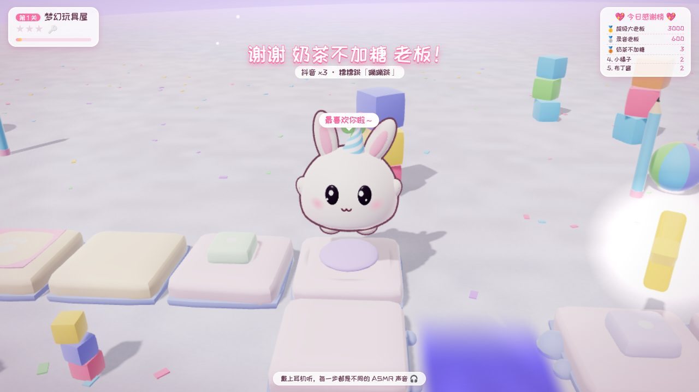
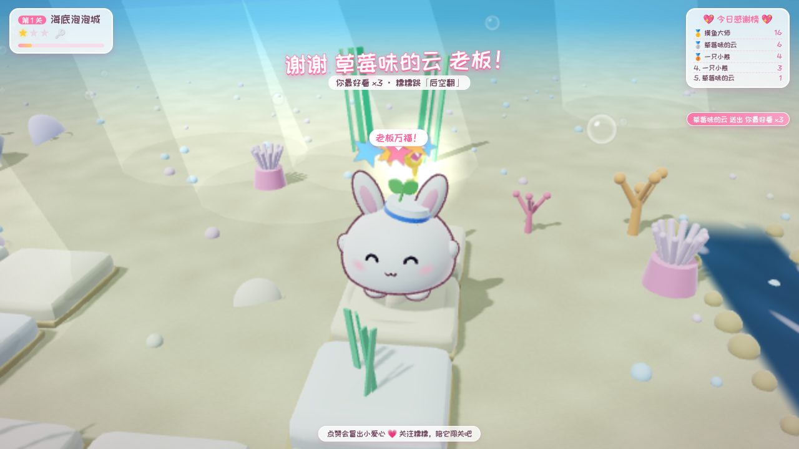
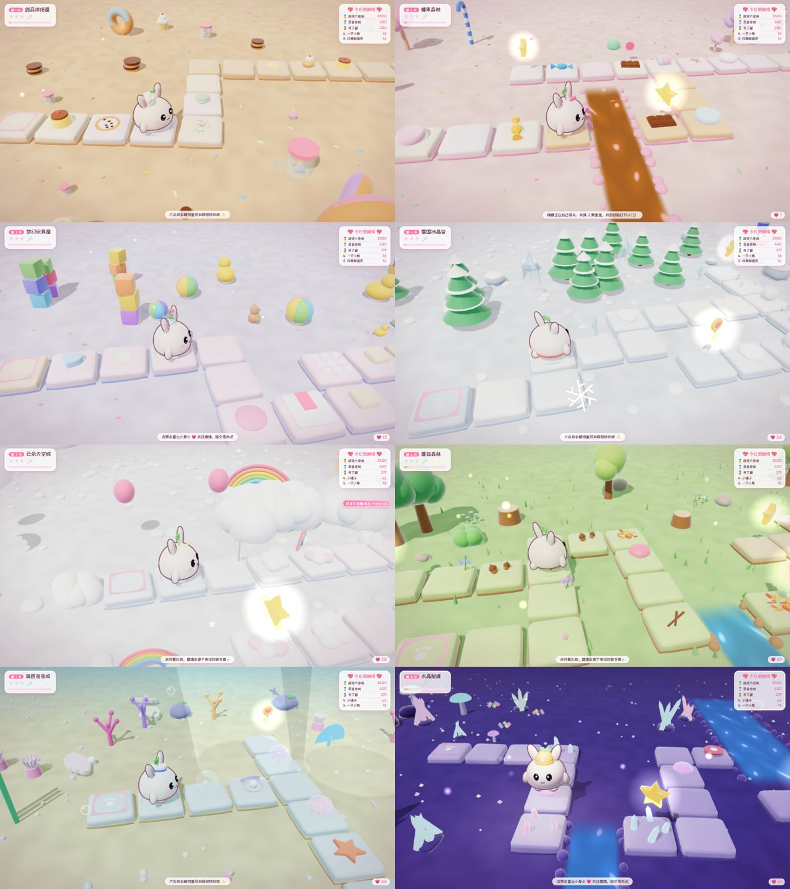
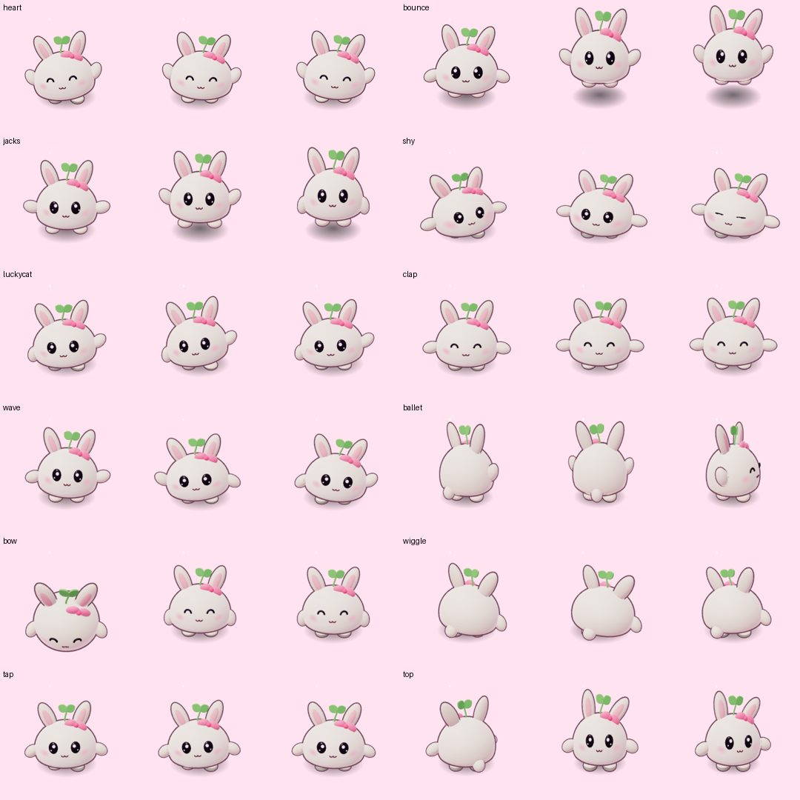
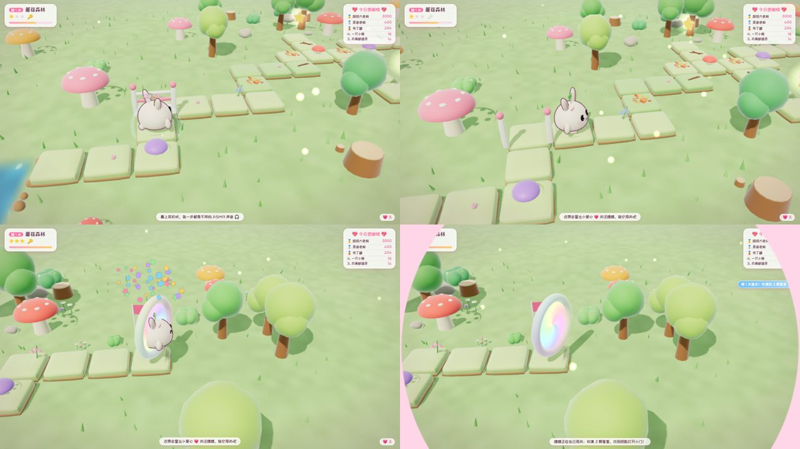
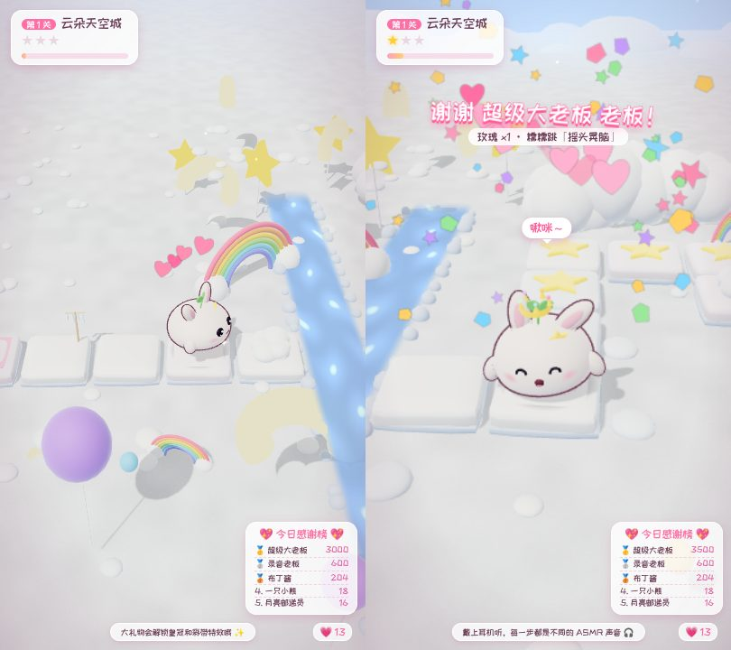

# 糯糯的 ASMR 奇遇 · 详细使用手册

> 一款为抖音直播打造的「ASMR + 萌宠 + 自动闯关」挂机直播项目。
> 原创 3D 萌宠「糯糯」会自己在 8 个风格各异的可爱世界里闯关，每一步踩到不同的东西都会发出不同的专业级 ASMR 声音；
> 有人送礼物时，糯糯会停下来随机跳一支舞，并显示「谢谢 XX 老板！」，然后继续闯关。开播后一直挂着就行，不需要人管。

---

## 目录

1. [它能做什么](#1-它能做什么)
2. [电脑要求](#2-电脑要求)
3. [三步快速开始](#3-三步快速开始)
4. [找到你的直播间号](#4-找到你的直播间号)
5. [抖音直播伴侣设置（重点）](#5-抖音直播伴侣设置重点)
6. [长时间挂机须知](#6-长时间挂机须知)
7. [礼物互动规则](#7-礼物互动规则)
8. [控制台使用说明](#8-控制台使用说明)
9. [ASMR 声音说明与替换成真实录音](#9-asmr-声音说明与替换成真实录音)
10. [自定义设置（config.json）](#10-自定义设置configjson)
11. [自检工具](#11-自检工具)
12. [常见问题与故障排查](#12-常见问题与故障排查)
13. [合规与风险提醒（务必阅读）](#13-合规与风险提醒务必阅读)
14. [技术原理（给想二次开发的人）](#14-技术原理给想二次开发的人)
15. [开源组件与致谢](#15-开源组件与致谢)

---

## 1. 它能做什么

| 需求 | 实现方式 |
|---|---|
| ASMR + 萌宠 + 闯关 | 糯糯沿着蜿蜒小路自动闯关：收集 3 颗星星、找钥匙开小门、跳过小河、踩弹簧垫飞越，最后跳进彩虹传送门进入下一关 |
| 原创、可爱的 3D 萌宠 | 「糯糯」是一颗软糯的麻薯团子，兔猫耳朵，头顶一棵小豆芽，水汪汪的大眼睛 + 腮红 + ω 小猫嘴；全部由代码程序化建模（不使用任何他人素材），带挤压拉伸、耳朵和豆芽的弹簧摆动、眨眼、表情变化 |
| 不同风格的场景 | 8 个世界轮流出现：糖果森林、海底泡泡城、雪国冰晶谷、蘑菇森林、甜品烘焙屋、云朵天空城、梦幻玩具屋、水晶秘境。每个世界有自己的配色、天空、装饰物、飘浮粒子、环境声、混响和糯糯的专属小配饰（蝴蝶结、水手帽、红围巾、小花、厨师帽、星星发卡、派对帽、矿工头盔） |
| 场景里有多种可踩的可爱元素，每种都有对应声音 | 共 **56 种可踩物件**（每个世界 6~8 种）+ 12 种地面脚步，每种都有专属的 ASMR 声音和互动表现（陷下去、弹起来、踩碎后复原、踩破后重生、溅水、发出乐音、滑行、连续踩爆……），见第 9 节完整列表 |
| 踩踏声音时长合理 | 每一类声音都有时长标准并自动检测：脚步 0.03~0.4 秒、软物 0.12~0.8 秒、主触发音 0.06~1.3 秒、乐音 0.3~3.5 秒；糯糯每跳一格约 0.5~0.6 秒，声音之间有呼吸感 |
| 专业的 ASMR 声音 | 基于物理模型现场合成（气泡共振模型、模态合成、颗粒合成），多变体随机轮换不重复，双耳 3D 声场（HRTF）跟随糯糯位置，每个场景独立混响，母线带压缩与限幅，整体响度约 -19 LUFS、峰值不削波 |
| 自主闯关，不用大模型但足够聪明 | 采用经典游戏 AI 做法：路径规划 + 效用打分 + 情绪状态 + 记忆。会判断要不要进支路拿星星、偶尔"忘了拿钥匙"走到门前才想起来回去找、在喜欢的东西上多踩几下、累了坐下歇会儿打哈欠、偏爱最近没听过的声音 |
| 送礼物 → 停下跳舞 + 谢谢老板 | 18 支舞蹈随机挑选（不连续重复），配五声音阶随机伴奏（每次都不一样），显示「谢谢 XX 老板！」横幅 + 头顶气泡；大礼物戴皇冠、撒彩带、跳多支舞；连击自动合并、小礼物刷屏自动攒着一起谢，保证闯关不会一直被打断 |
| 开播后一直挂着不用管 | 一键启动；看门狗：游戏页面卡死/崩溃/被关掉会自动重开；监听断线自动重连、长时间没数据自动刷新；程序崩溃自动重启；每 6 小时在关卡之间自动刷新释放内存；感谢榜每天自动清零 |

效果截图：








---

## 2. 电脑要求

- **系统**：Windows 10 / 11（64 位）。macOS / Linux 也能运行（用 `node server/index.js` 启动）。
- **浏览器**：Google Chrome 或 Microsoft Edge（Windows 自带 Edge，无需另装）。
- **显卡**：近 5 年的集成显卡即可流畅运行（程序会自动调节画质）；独立显卡更好。
- **网络**：能正常打开抖音网页直播间即可。
- **抖音直播伴侣**：电脑版，已开通直播权限。
- **Node.js**：不需要手动安装——第一次双击启动时会自动下载便携版（约 30MB，已做 SHA256 校验）。如果你已经装了 Node.js 22 或更新版本，会直接使用。

> 路径里可以有中文。建议放在 `D:\糯糯直播\` 这类固定位置，不要放在桌面的临时文件夹里。

---

## 3. 三步快速开始

**第 1 步：下载**

在 GitHub 页面点击 `Code → Download ZIP`，解压到一个固定的文件夹（或者用 `git clone`）。

**第 2 步：双击 `启动糯糯.bat`**

- 第一次运行会自动准备运行环境（需要联网，约 1 分钟）。
- 随后会自动弹出两个窗口：
  - **游戏窗口**「糯糯的ASMR奇遇」——这就是要推给观众看的画面；
  - **控制台**（浏览器打开 `http://127.0.0.1:17890/admin`）——只有你自己能看到。
- 黑色的命令行窗口不要关（可以最小化），关掉它程序就退出了。

**第 3 步：在控制台填写直播间号并保存**

在控制台「设置」里填上你的直播间号（见第 4 节），点「保存设置」。状态栏「直播数据」显示绿色「正在监听」就成功了。

然后按第 5 节在直播伴侣里添加游戏窗口，开播即可。

> 想先看效果？双击 `演示模式.bat`，糯糯会收到随机模拟的礼物，不需要开播。
> 也可以在控制台点「🎁 测试」里的按钮，手动模拟各种礼物。

关闭程序：双击 `停止糯糯.bat`，或直接关掉黑色命令行窗口。

---

## 4. 找到你的直播间号

任选一种：

1. **最简单**：直接填你的**抖音号**（个人主页上「抖音号：xxxx」那一串）。程序会打开 `https://live.douyin.com/你的抖音号`。
2. 开播后，用电脑浏览器打开你的直播间，地址栏形如 `https://live.douyin.com/123456789012`，最后那串数字就是直播间号。
3. 直接把整个地址粘贴进去也可以，程序会自动提取。

验证方法：用浏览器打开 `https://live.douyin.com/你填的内容`，能看到你的直播间就对了。

---

## 5. 抖音直播伴侣设置（重点）

### 5.1 选择横屏还是竖屏

| | 横屏 16:9 | 竖屏 9:16 |
|---|---|---|
| 适合 | 电脑/平板观众多 | 手机观众多（抖音大部分） |
| 直播伴侣 | 选「横屏」 | 选「竖屏」 |
| 游戏窗口大小 | `gameWindow` 设为 1280×720 或 1920×1080 | `gameWindow` 设为 608×1080 或 720×1280 |
| 布局 | 控制台「画面布局」选横屏或自动 | 控制台「画面布局」选竖屏或自动 |

修改窗口大小：用记事本打开 `config.json`，改 `gameWindow` 里的 `width`/`height`，重启程序。
画面布局「自动」会根据窗口宽高自动切换横/竖屏界面。

> 小技巧：如果显示器是 1920×1080，竖屏窗口最高只能接近 1080，推荐 608×1080（正好 9:16），推流时直播伴侣会自动放大到竖屏画布，清晰度足够。

### 5.2 添加游戏画面

1. 打开抖音直播伴侣 → 选择横屏/竖屏。
2. 点击「添加素材」→ 选择「**窗口**」（也叫"窗口捕获"）。
3. 在列表里选择 **「糯糯的ASMR奇遇」**（进程是 chrome.exe 或 msedge.exe）。
4. 拖动/缩放素材让它铺满画布；如果边上有一条窗口标题栏，可以用直播伴侣的「裁剪」把它裁掉，或者把 `gameWindow.fullscreen` 设为 `true`（全屏显示，适合有第二块显示器的情况）。

**画面黑屏怎么办？**
- 在直播伴侣里删掉素材重新添加，或试试「全屏/显示器捕获」+ 裁剪；
- 确认游戏窗口**没有最小化**（最小化的窗口 Windows 不会绘制画面）。被别的窗口挡住没关系，但不要最小化；
- 仍然黑屏：在 Windows「设置 → 显示 → 图形」里，把直播伴侣和 Chrome/Edge 设为同一块显卡（都选"高性能"）。

### 5.3 声音

- 直播伴侣默认会采集「电脑声音/扬声器」，糯糯的声音就会推到直播里。请确认直播伴侣里电脑声音没有被静音。
- **监听抖音用的浏览器已经自动静音，并且不加载直播视频流**，所以不会出现"自己的直播声音被录回去"的回声。
- 无人值守时建议**关闭麦克风**，避免把房间里的杂音推出去。
- 想让观众戴耳机有"双耳立体声"的沉浸感：保持 `audio.spatial` 为 `hrtf`（默认）。如果你觉得手机外放听着不舒服，可以改成 `stereo`。

### 5.4 推荐的直播伴侣画质

- 分辨率：横屏 1920×1080 / 竖屏 1080×1920（或 720×1280）
- 帧率：30 帧足够（游戏本身 60 帧更流畅）
- 码率：按直播伴侣推荐即可

---

## 6. 长时间挂机须知

程序本身为 7×24 小时运行设计（自动恢复、内存定期清理），电脑也需要配合：

1. **电源**：控制面板 → 电源选项 → 选「高性能」，「关闭显示器」和「使计算机进入睡眠」都设为「从不」。
2. **关闭屏幕保护**。
3. **暂停 Windows 更新**（设置 → Windows 更新 → 暂停更新），避免半夜自动重启。
4. **不要最小化游戏窗口**（可以被其他窗口挡住，或者放到第二块屏幕）。
5. **杀毒软件**：如果提示拦截 `node.exe` 或浏览器的调试端口，请选择信任/允许。
6. 每天看一眼控制台：状态全部为绿色即正常。
7. 日志在 `logs` 文件夹里（按天保存 7 天），出问题时可以发给技术人员排查。

程序内置的自动恢复：

| 情况 | 自动处理 |
|---|---|
| 游戏页面卡死（60 秒没心跳） | 自动关闭并重新打开游戏窗口 |
| 游戏窗口被误关 | 3 秒后自动重新打开 |
| 渲染出错 / 显卡驱动重置 | 页面自动刷新恢复 |
| 某一关出错 | 自动跳到下一关，不会停住 |
| 糯糯卡住（40 秒没进展） | 自动"瞬移"到前方继续 |
| 一关太久 | 超时自动通关 |
| 抖音监听断线 / 150 秒收不到数据 | 自动刷新直播间页面；多次无效则重启监听浏览器 |
| 程序崩溃 | 启动脚本 5 秒后自动重启 |
| 长时间运行 | 每 6 小时在关卡切换时自动刷新页面，释放内存 |
| 页面刷新/重连期间的礼物 | 服务器缓存 2 分钟内的事件，重连后补发，不会漏谢 |

---

## 7. 礼物互动规则

### 7.1 礼物分级（可在 config.json 的 `game.gifts.tierThresholds` 修改）

| 等级 | 礼物价值（抖币，含连击总数） | 糯糯的表现 |
|---|---|---|
| 小礼物 | 1~9 | 停下跳 1 支舞（约 5.5 秒） |
| 中礼物 | 10~99 | 跳 1 支舞（约 7.5 秒），特效更多 |
| 大礼物 | 100~999 | 戴上皇冠、撒彩带，连跳 2 支舞 |
| 超级礼物 | ≥1000 | 皇冠 + 彩带 + 金色超级横幅，连跳 3 支舞 |

每次答谢都会显示：

- 顶部横幅：「谢谢 XX 老板！」+「礼物名 ×数量 · 糯糯跳「舞蹈名」」
- 糯糯头顶的气泡：随机的可爱台词（谢谢老板～♥、老板大气！、比心心～、啾咪～……）
- 右侧礼物提示条：**每一份礼物到达时都会立刻显示**，即使糯糯还在跳上一支舞
- 右上角「今日感谢榜」：按抖币累计，每天早上 5 点自动清零

### 7.2 智能调度（不需要大模型）

- **连击合并**：同一个人连续送同一种礼物，合并成一次答谢，显示 ×N。
- **大礼物插队**：大礼物永远优先答谢。
- **防刷屏**：小礼物答谢之间有冷却（默认 14 秒），冷却期间收到的小礼物会攒起来，下一次集体答谢「谢谢 A、B、C 等 5 位老板们！」。
- **保证闯关进度**：最近 1 分钟里跳舞时间超过 65% 时，小礼物会先排队，让糯糯先往前走几步；大礼物不受限制。
- **队列太长自动合并**：避免一直跳舞跳不完。
- **停下的时机自然**：糯糯会在当前这一跳落地后停下来，转身面向观众，镜头自动拉近（并自动避开挡住它的星星、装饰物）。

### 7.3 18 支舞蹈

摇摆舞、转圈圈、蹦蹦跳、比心心、波浪手、招财猫、扭屁屁、太空步、小陀螺、鞠躬致谢、开合跳、小鸭步、后空翻（大礼物更常出现）、踢踏舞（带踢踏声）、摇头晃脑、芭蕾转转、拍拍手（带拍手声）、害羞羞。最近跳过的 5 支不会马上重复。

### 7.4 其他互动

- **点赞**：糯糯头上冒出小爱心（有节流，不会刷屏），右下角显示点赞数。
- **关注**：显示「欢迎 XX 关注糯糯～」，糯糯会挥手说「谢谢 XX 的关注～」。
- **进入直播间**：显示「欢迎 XX 来看糯糯～」（每 10 秒最多一条，可在控制台关闭）。
- 所有昵称都会过滤特殊字符并截断过长的名字，不会出现乱码或恶意代码。

---

## 8. 控制台使用说明

地址：`http://127.0.0.1:17890/admin`（只能在这台电脑上打开，观众看不到）。

- **运行状态**：直播数据是否在监听、收到多少数据、游戏帧率、声音是否正常、当前第几关、最近错误。
- **设置**：直播间号、数据来源、画面布局、四路音量（总音量 / 踩踏声 / 环境声 / 舞蹈音乐）、是否显示物件名字标签、是否显示进房提示、是否显示监听浏览器窗口。点「保存设置」后游戏页面自动刷新生效。「只试听音量」可以先试听再决定是否保存。
- **测试**：一键模拟小心心、玫瑰、加油鸭、比心兔兔、嘉年华等不同价值的礼物，以及点赞、关注、进房；也可以自定义昵称、礼物名、抖币。
- **操作**：跳过本关、刷新游戏页面、重启游戏窗口、重连直播间、清空感谢榜。
- **最近礼物**与**今日感谢榜**。

---

## 9. ASMR 声音说明与替换成真实录音

### 9.1 声音是怎么做出来的

所有声音都由程序按物理原理**现场合成**（不使用任何有版权的音效素材），每次启动、每个场景都会生成，并且每种声音有 4~10 个不同的变体随机轮换，播放时还会轻微随机音高和音量，所以长时间直播也不会听出重复感：

- **水声**（水洼、泡泡、水滴、黏液里的小气孔）：采用 van den Doel 气泡共振物理模型（Minnaert 频率），水滴"叮咚"的上滑音、溅水时的一串小气泡都来自它。
- **敲击声**（木头、石头、玻璃、水晶、冰棱、宝石、键帽）：模态合成——模拟物体本身的共振频率和衰减，硬的东西更亮、软的东西更闷。
- **碎裂/揉搓声**（雪地咯吱、落叶沙沙、饼干咔嚓、糖纸、跳跳糖、太空沙）：颗粒合成——成百上千个微小的随机"颗粒"按压缩过程的节奏排列。
- **软糯声**（棉花糖、云朵、奶油、果冻、史莱姆）：时变滤波噪声 + 低频"啵嘤"弹性振动 + 湿润的小气泡。
- **乐音**（彩虹琴键、玩具钢琴、星星砖、风铃、水晶）：全部在 C 大调五声音阶上，连成一串的琴键会自动谱成一小段旋律，任何组合都和谐。

播放端的专业处理：

- **双耳 3D 声场（HRTF）**：声音跟随糯糯在画面中的左右位置，戴耳机能听出方位。
- **场景声学**：每个世界独立混响——水晶洞 3 秒的空灵回声、雪地几乎没有回声（雪吸音）、海底闷闷的低通音色。
- **母线处理**：低切去除隆隆声 → 轻微暖声与空气感 EQ → 胶水压缩 → 限幅器 → 软削波保险。实测整体响度约 **-19.6 LUFS**、响度范围 4.7 LU、峰值 -1.8 dBFS，不会忽大忽小、不会爆音。
- **环境声**：每个世界有循环的底噪（微风、海底、冬风、林间溪流、暖炉柴火、高空风、安静房间、洞穴），外加实时随机出现的鸟鸣、水滴、远处风铃等，永不重复。
- **复音管理**：同时最多 28 个声音，超出时最早的声音淡出，不会堆成一团。

### 9.2 每个世界的可踩物件与声音

#### 糖果森林（candy）

| 可踩物件 | 声音 ID | 互动 | 声音时长 |
|---|---|---|---|
| 软绵绵棉花糖 | `marshmallow` | 软软陷下去 | 0.30–0.41 秒 |
| Q弹果冻 | `jelly` | Q弹弹起 | 0.50–0.68 秒 |
| 沙沙糖纸 | `candy_wrapper` | 揉搓 | 0.51–0.61 秒 |
| 咔嚓巧克力 | `chocolate` | 踩碎→复原 | 0.14–0.20 秒 |
| 噼啪跳跳糖 | `popping_candy` | 噼里啪啦 | 0.91–1.02 秒 |
| 小熊软糖 | `gummy` | 软软陷下去 | 0.23–0.23 秒 |
| 蓬松棉花糖 | `cotton_candy` | 软软陷下去 | 0.31–0.43 秒 |

地面脚步：`step_candy`、`step_cookie`

#### 海底泡泡城（ocean）

| 可踩物件 | 声音 ID | 互动 | 声音时长 |
|---|---|---|---|
| 啵啵泡泡 | `bubble_pop` | 踩破→重生 | 0.07–0.11 秒 |
| 咔哒贝壳 | `seashell` | 踩碎→复原 | 0.12–0.14 秒 |
| 叮咚珍珠 | `pearl` | 发出乐音 | 0.73–0.75 秒 |
| 摇摇海草 | `seaweed` | 软软陷下去 | 0.46–0.58 秒 |
| 软软海星 | `starfish` | 软软陷下去 | 0.23–0.29 秒 |
| 弹弹水母 | `jellyfish` | Q弹弹起 | 0.75–0.75 秒 |
| 小水潭 | `sea_splash` | 溅水花 | 0.38–0.44 秒 |

地面脚步：`step_sand`、`step_stone`

#### 雪国冰晶谷（snow）

| 可踩物件 | 声音 ID | 互动 | 声音时长 |
|---|---|---|---|
| 咯吱雪堆 | `snow_pile` | 踩碎→复原 | 0.34–0.45 秒 |
| 滑溜溜冰面 | `ice_slide` | 滑行 | 0.75–0.77 秒 |
| 冰棱风铃 | `icicle` | 发出乐音 | 1.89–1.94 秒 |
| 圆滚滚雪球 | `snowman` | 踩碎→复原 | 0.31–0.32 秒 |
| 冰晶花 | `frost_flower` | 发出乐音 | 1.29–1.33 秒 |
| 薄冰 | `ice_crack` | 踩碎→复原 | 0.20–0.24 秒 |

地面脚步：`step_snow`、`step_ice`

#### 蘑菇森林（forest）

| 可踩物件 | 声音 ID | 互动 | 声音时长 |
|---|---|---|---|
| 啵嘤蘑菇 | `mushroom` | Q弹弹起 | 0.54–0.54 秒 |
| 沙沙落叶 | `leaf_pile` | 踩碎→复原 | 0.42–0.56 秒 |
| 咔嚓小树枝 | `twig` | 踩碎→复原 | 0.18–0.21 秒 |
| 啪嗒水洼 | `puddle` | 溅水花 | 0.27–0.36 秒 |
| 小橡果 | `acorn` | 踩碎→复原 | 0.18–0.24 秒 |
| 咚咚木桩 | `log` | 软软陷下去 | 0.27–0.28 秒 |
| 荷叶 | `lily_pad` | 溅水花 | 0.31–0.39 秒 |
| 风铃花 | `flower_bell` | 发出乐音 | 1.35–1.39 秒 |

地面脚步：`step_grass`、`step_moss`、`step_wood`

#### 甜品烘焙屋（bakery）

| 可踩物件 | 声音 ID | 互动 | 声音时长 |
|---|---|---|---|
| 酥脆马卡龙 | `macaron` | 踩碎→复原 | 0.27–0.27 秒 |
| 咔嚓饼干 | `biscuit` | 踩碎→复原 | 0.21–0.32 秒 |
| 奶油泡芙 | `cream_puff` | 软软陷下去 | 0.29–0.38 秒 |
| 晃晃布丁 | `pudding` | Q弹弹起 | 0.62–0.62 秒 |
| 方糖 | `sugar_cube` | 踩碎→复原 | 0.18–0.19 秒 |
| 黏黏蜂蜜 | `honey` | 黏黏拉丝 | 0.59–0.78 秒 |
| 软软甜甜圈 | `donut` | 软软陷下去 | 0.28–0.29 秒 |
| 彩虹糖针 | `sprinkles` | 噼里啪啦 | 0.32–0.41 秒 |

地面脚步：`step_wood`、`step_cookie`、`step_candy`

#### 云朵天空城（sky）

| 可踩物件 | 声音 ID | 互动 | 声音时长 |
|---|---|---|---|
| 软绵绵云朵 | `cloud_puff` | 软软陷下去 | 0.38–0.50 秒 |
| 星星砖 | `star_tile` | 发出乐音 | 1.90–1.90 秒 |
| 彩虹琴键 | `rainbow` | 发出乐音 | 0.95–0.96 秒 |
| 小风铃 | `wind_chime` | 发出乐音 | 2.13–2.42 秒 |
| 轻羽毛 | `feather` | 软软陷下去 | 0.37–0.46 秒 |
| 弹力云 | `sky_bounce` | Q弹弹起 | 0.54–0.54 秒 |
| 啵啵泡泡 | `bubble_pop` | 踩破→重生 | 0.07–0.11 秒 |

地面脚步：`step_cloud`、`step_crystal`

#### 梦幻玩具屋（toy）

| 可踩物件 | 声音 ID | 互动 | 声音时长 |
|---|---|---|---|
| 噼啪气泡膜 | `bubble_wrap` | 连续踩爆 | 0.05–0.05 秒 |
| 咔哒键帽 | `keycap` | 软软陷下去 | 0.11–0.12 秒 |
| 积木 | `wood_block` | 软软陷下去 | 0.17–0.23 秒 |
| 吱吱毛绒 | `plush` | 软软陷下去 | 0.19–0.26 秒 |
| 咕叽史莱姆 | `slime` | 黏黏拉丝 | 0.41–0.50 秒 |
| 玩具钢琴 | `piano_key` | 发出乐音 | 1.69–1.69 秒 |
| 沙沙太空沙 | `kinetic_sand` | 软软陷下去 | 0.36–0.41 秒 |
| 脆脆肥皂 | `soap` | 踩碎→复原 | 0.28–0.33 秒 |

地面脚步：`step_plush`、`step_wood`

#### 水晶秘境（cave）

| 可踩物件 | 声音 ID | 互动 | 声音时长 |
|---|---|---|---|
| 空灵水晶 | `crystal` | 发出乐音 | 2.30–2.35 秒 |
| 叮咚水滴 | `cave_drip` | 溅水花 | 0.19–0.28 秒 |
| 亮晶晶宝石 | `gem` | 发出乐音 | 0.50–0.53 秒 |
| 冰糖晶石 | `rock_sugar` | 踩碎→复原 | 0.33–0.36 秒 |
| 荧光蘑菇 | `glow_mushroom` | Q弹弹起 | 1.20–1.20 秒 |
| 石板 | `stalagmite` | 软软陷下去 | 0.13–0.13 秒 |

地面脚步：`step_stone`、`step_crystal`

另外还有闯关音效（收集星星、拿到钥匙、开门、弹簧垫、起跳/落地、过关、传送门）、互动音效（礼物闪光、点赞小爱心）、舞蹈伴奏乐器（卡林巴、贝斯、底鼓、沙锤、拍手、踢踏），以及糯糯自己的萌系小声音（开心、惊讶、耶、好奇、困困、谢谢）。

### 9.3 换成你自己的真实录音（可选）

如果你有专业 ASMR 录音（比如用双耳麦克风录的史莱姆、雪地），可以替换任意一种声音：

1. 在 `assets/sounds/` 下新建一个文件夹，名字就是上表里的**声音 ID**，例如 `assets/sounds/slime/`。
2. 把录音文件放进去，支持 `wav / mp3 / ogg / m4a / flac`，可以放多个（会随机轮换，越多越不重复）。
3. 每个文件建议只包含**一次**完整的触发声（例如踩一下史莱姆的声音），时长参考上表，开头不要留空白。
4. 刷新游戏页面即可生效。程序会自动把音量对齐到同类声音的标准响度，不用担心忽大忽小。

> 删掉文件夹就恢复成程序合成的声音。

---

## 10. 自定义设置（config.json）

`config.json` 在第一次启动时由 `config.example.json` 复制生成，里面每一项都有中文注释。常用项：

| 设置 | 说明 |
|---|---|
| `room` | 直播间号或抖音号 |
| `source` | `douyin`（推荐）/ `barragegrab`（备用）/ `mock`（演示）/ `none` |
| `gameWindow.width/height` | 游戏窗口大小（横屏 1280×720、竖屏 608×1080 等） |
| `gameWindow.fullscreen` | 游戏窗口全屏 |
| `game.layout` | `auto` / `landscape` / `portrait` |
| `game.themes` | 只想要部分世界，例如 `["candy","ocean","snow"]` |
| `game.levelBudget` | 每关期望时长（秒），默认 170 |
| `game.audio.*` | 各路音量与 `spatial`（hrtf/stereo） |
| `game.gifts.tierThresholds` | 礼物分级阈值，默认 `[10, 100, 1000]` |
| `game.gifts.smallCooldown` | 小礼物答谢冷却秒数 |
| `game.gifts.giftValues` | 当拿不到礼物价格时，按礼物名估算抖币 |
| `game.hud.tips` | 底部轮播提示文字（自定义你的直播间口号） |
| `game.hud.showBoard` | 是否显示感谢榜 |
| `game.reloadHours` | 每隔几小时自动刷新页面（默认 6） |
| `board.resetHour` | 感谢榜每天几点清零（默认 5 点） |
| `listener.visible` | 显示监听浏览器（需要登录/验证时临时打开） |

改完保存，重启程序（或在控制台改，自动生效）。如果 `config.json` 写错了格式，程序会在命令行提示并使用默认配置，不会无法启动。

---

## 11. 自检工具

**最简单：双击 `自检.bat`**，会依次运行下面的程序自检和直播监听链路自检，最后显示结果。

也可以在项目文件夹里打开命令行（地址栏输入 `cmd` 回车），分别运行：

```bat
runtime\node\node.exe tools\selftest.mjs
```

（如果你自己装了 Node.js，直接 `node tools\selftest.mjs`。）会检查 32 项：抖音协议解码、礼物连击去重、BarrageGrab 对接、配置解析、480 个随机关卡的可解性、AI 能否全部自主通关、礼物答谢调度、101 种声音 / 579 个变体的质量（无削波、无爆音、时长合理）。

```bat
runtime\node\node.exe tools\test-listener.mjs
```

在本机模拟一个"假直播间"推送和抖音一样格式的礼物数据，用你电脑上的真实浏览器去监听，验证监听链路在你的电脑上能工作（不需要开播）。加 `--show` 可以看到浏览器窗口。

```bat
runtime\node\node.exe tools\render-sounds.mjs sounds_out
```

把全部声音渲染成 WAV 文件到 `sounds_out` 文件夹，可以直接用耳机试听每一种声音。

---

## 12. 常见问题与故障排查

**Q：控制台显示「暂无数据」或「连接中」一直不变？**
- 确认你**已经开播**，并且直播间号正确（第 4 节的验证方法）。
- 抖音网页有时需要登录或滑块验证：在控制台勾选「显示监听浏览器窗口」并保存，会出现一个浏览器窗口，在里面登录/完成验证后，再取消勾选保存。登录状态会被记住。
- 网络问题：程序每 150 秒没数据会自动刷新，多次无效会重启监听浏览器，通常能自己恢复。

**Q：抖音网页改版导致监听失效怎么办？**
本项目的默认方案是"让浏览器自己打开直播间，再读取浏览器收到的数据"，签名加密都由浏览器完成，抗改版能力较强。如果仍然失效，可以切换到备用方案：
1. 下载开源工具 [DouyinBarrageGrab](https://github.com/HaoDong108/DouyinBarrageGrab)（发行版在其 Gitee 页面），按它的说明以管理员身份运行 `WssBarrageService.exe`；
2. 控制台把「礼物数据来源」改成「BarrageGrab 弹幕工具」，保存。它默认在 `ws://127.0.0.1:8888` 推送，本程序会自动对接。

**Q：游戏窗口没有声音 / 控制台显示「声音未开启」？**
程序启动的游戏窗口已经设置了"允许自动播放声音"。如果你是手动用浏览器打开的游戏页面，需要在页面上点一下（会有提示）。另外检查 Windows 音量合成器里 Chrome/Edge 没有被静音。

**Q：画面卡顿？**
程序会自动降低分辨率保持流畅。也可以在 `config.json` 里把 `game.pixelRatio` 调到 `1`、`game.shadowSize` 调到 `1024`；把游戏窗口调小（例如 1280×720）也会明显减轻压力。

**Q：提示「端口 17890 被占用」？**
在 `config.json` 里把 `port` 改成别的数字（比如 17990），重启。

**Q：提示「糯糯已经在运行了」？**
说明已经有一个在运行，不用重复启动。控制台地址照常打开即可。

**Q：自动下载 Node.js 失败？**
到 https://nodejs.org/zh-cn/download 下载安装 LTS 版本（22 或更新），装好后再双击 `启动糯糯.bat`。

**Q：画面模糊？**
如果 Windows 显示缩放不是 100%，可以在 `config.json` 的 `gameWindow.deviceScaleFactor` 填 `1`，或者把游戏窗口调大。

**Q：想换糯糯的名字/台词/提示语？**
提示语在 `config.json` 的 `game.hud.tips`；答谢台词在 `web/js/game/game.js` 顶部的 `THANK_LINES`；用记事本就能改。

---

## 13. 合规与风险提醒（务必阅读）

1. **平台规则**：请遵守《抖音直播行为规范》等平台规则。平台对"无人直播 / 录播 / 长时间挂机"有管理要求，本项目是**实时响应观众礼物的互动内容**（每一份礼物都会被即时答谢，画面和声音实时生成、不是录播），但平台仍可能根据自身规则判定，请自行评估风险，必要时安排人员巡视或在合适的时段开播。
2. **数据获取方式**：本项目读取的是**你自己的直播间**里所有观众都能看到的公开信息（礼物、点赞、关注提示），只在你的电脑本地使用、不上传、不存储观众隐私（感谢榜只保存昵称和抖币数）。抖音官方的合规接入方式是「抖音开放平台 · 直播小玩法」（需要企业资质申请）；第三方读取方式（包括本项目和 BarrageGrab）属于非官方方式，抖音改版可能导致失效，请知悉。
3. **不要诱导消费**：请不要使用夸大、承诺回报、针对未成年人诱导打赏的话术；本项目默认的提示语只是说明"送礼物糯糯会跳舞"。
4. **原创与版权**：糯糯的形象、所有 3D 模型和所有声音都由代码原创生成；字体「站酷快乐体」使用 SIL OFL 开源授权，可免费商用；three.js 使用 MIT 授权。

---

## 14. 技术原理（给想二次开发的人）

```
┌────────────────── 你的电脑 ──────────────────┐
│                                              │
│  抖音直播伴侣 ←── 窗口捕获 ── 游戏窗口(Chrome/Edge)
│                                   │  ▲         │
│                         心跳/日志 │  │ SSE 推送礼物事件（断线补发）
│                                   ▼  │         │
│                  本地服务 server/index.js（Node.js，零依赖）
│                   │  ├─ 看门狗：卡死/关闭自动重开
│                   │  ├─ 感谢榜（每天清零）
│                   │  └─ 控制台 /admin
│                   ▼                          │
│        监听浏览器（静音、不拉视频流）            │
│        打开 live.douyin.com/直播间号            │
│        CDP 读取弹幕 WebSocket 数据帧            │
│        → gzip 解压 → protobuf 解码 → 连击去重    │
└──────────────────────────────────────────────┘
```

- **游戏**（`web/`）：three.js r170，原生 ES Module，无需构建。
  - `js/pet/`：糯糯模型（程序化建模、描边、表情）、动画（挤压拉伸、弹簧次级运动）、18 支舞蹈。
  - `js/world/`：8 个主题、56 种可踩物件、43 种装饰物（静态合批，几次绘制调用）、关卡程序化生成与可解性校验。
  - `js/ai/brain.js`：目标规划 + 效用打分 + 情绪 + 记忆的自主闯关 AI。
  - `js/audio/`：DSP 合成库、声音配方、Web Audio 播放引擎（Worker 合成、HRTF、混响、母线、环境声、音序器）。
  - `js/game/`：关卡循环、踩踏反馈、礼物答谢调度。
- **服务**（`server/`）：Node.js 22+ 内置模块实现 HTTP/SSE、CDP 客户端（内置 WebSocket）、protobuf 解码（只按字段号取需要的字段，抗协议变化）。
- **测试**（`tools/`）：单元自检、监听链路端到端测试、声音渲染与质量检查。

开发调试：

```bash
node server/index.js --mock --no-launch   # 演示数据，不自动开窗口
# 浏览器打开 http://127.0.0.1:17890/        游戏
#            http://127.0.0.1:17890/admin   控制台
# 调试参数：?themes=toy  只玩某个世界；?layout=portrait 强制竖屏；?sim=8 快进 8 倍（自检用）
```

---

## 15. 开源组件与致谢

- [three.js](https://threejs.org/)（MIT）——3D 渲染引擎
- [站酷快乐体 ZCOOL KuaiLe](https://fonts.google.com/specimen/ZCOOL+KuaiLe)（SIL Open Font License 1.1）——界面字体，许可见 `web/fonts/OFL.txt`
- 抖音直播消息字段号参考了开源项目 [DouyinLiveWebFetcher](https://github.com/saermart/DouyinLiveWebFetcher) 与 [DouyinBarrageGrab](https://github.com/HaoDong108/DouyinBarrageGrab) 公开的 proto 定义
- 气泡声音模型参考 K. van den Doel, *Physically-Based Models for Liquid Sounds*（ACM TAP 2005）
