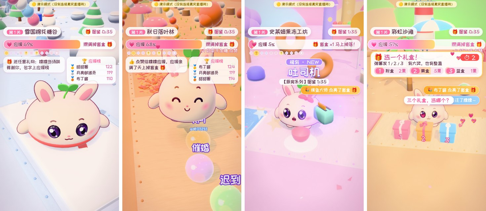
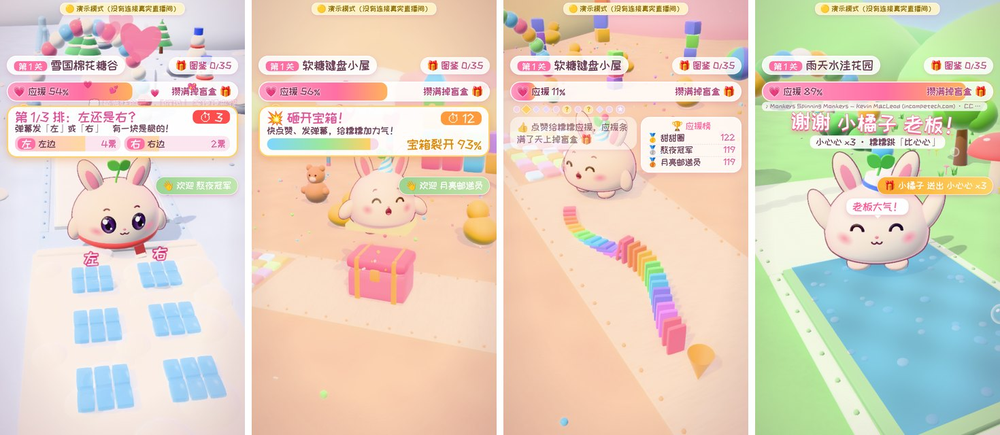
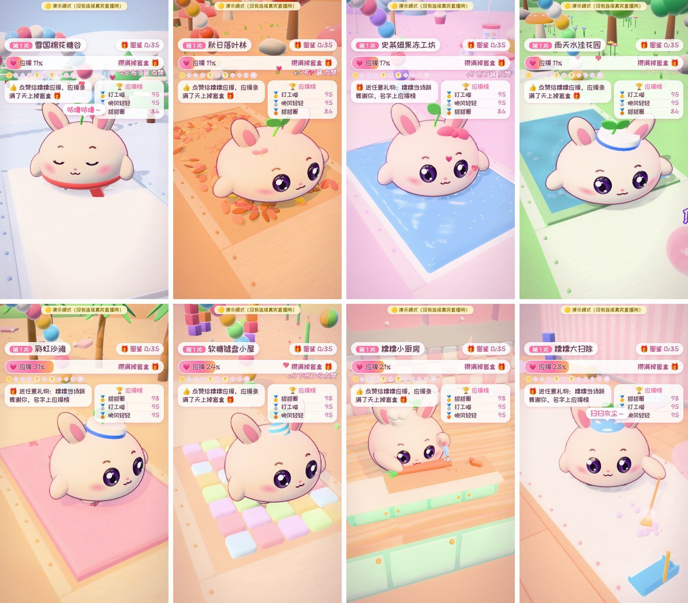
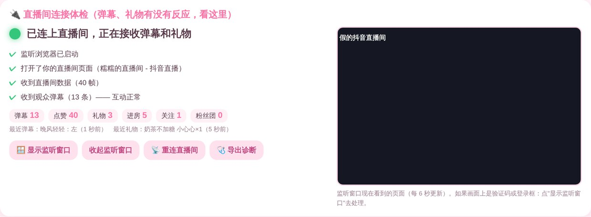

# 糯糯的 ASMR 奇遇（竖屏互动版 v4）· 详细使用手册

> 一款为抖音直播打造的「真实 ASMR 录音 + 原创 3D 萌宠 + 解压闯关 + 弹幕互动」项目。
> 原创萌宠「糯糯」一关一关往前闯：踩粉雪、坐史莱姆、把观众写的烦恼一个个踩扁、推倒一长串多米诺、开盲盒、在三个礼盒里赌大奖、走"一踩就碎"的脆脆桥、在终点砸宝箱……
> **观众的每一个动作画面上都立刻有反应**：点赞让应援条上涨，条满了天上掉盲盒；弹幕可以投票、写烦恼、指挥糯糯；关注、加粉丝团会被点名感谢；送礼物糯糯当场跳舞说「谢谢 XX 老板！」。
> 画面默认是**竖屏 9:16**，专门为手机观看排版。

---

## 目录

1. [它能做什么](#1-它能做什么)
2. [电脑要求](#2-电脑要求)
3. [三步快速开始](#3-三步快速开始)
4. [找到你的直播间号](#4-找到你的直播间号)
5. [抖音直播伴侣设置（竖屏）](#5-抖音直播伴侣设置竖屏)
6. [开播前必做：连接体检](#6-开播前必做连接体检)
7. [观众怎么玩：每一种互动画面上有什么反应](#7-观众怎么玩每一种互动画面上有什么反应)
8. [一关里有什么](#8-一关里有什么)
9. [礼物答谢规则](#9-礼物答谢规则)
10. [弹幕指令与投票下一关](#10-弹幕指令与投票下一关)
11. [控制台使用说明](#11-控制台使用说明)
12. [运营建议（简版）](#12-运营建议简版)
13. [长时间运行须知](#13-长时间运行须知)
14. [ASMR 声音（全部是真实录音）](#14-asmr-声音全部是真实录音)
15. [自定义设置（config.json）](#15-自定义设置configjson)
16. [自检工具](#16-自检工具)
17. [常见问题与故障排查](#17-常见问题与故障排查)
18. [合规与风险提醒（务必阅读）](#18-合规与风险提醒务必阅读)
19. [技术原理（给想二次开发的人）](#19-技术原理给想二次开发的人)
20. [开源组件、素材与致谢](#20-开源组件素材与致谢)

---

## 1. 它能做什么

v4 是照着直播实测暴露的问题改的：

| 实测的问题 | 现在是怎样 |
|---|---|
| 观众竖着拿手机看，横屏画面只有一小条，字看不清 | **默认竖屏 9:16**。抖音自己的界面会盖住画面最上面一条和下面三分之一多（评论区、礼物栏），所以糯糯和所有文字都排在中间这一段；字号按手机观看重新定过 |
| 发弹幕、送礼物，画面没反应 | 两头都修了：① 监听重写（按数据内容找弹幕通道、自动处理验证码 / 登录 / 没开播 / 直播间号填错，并在控制台用大白话告诉你卡在哪，见[第 6 节](#6-开播前必做连接体检)）；② 游戏里**每一种互动半秒内就有反应**（[第 7 节](#7-观众怎么玩每一种互动画面上有什么反应)），不再等糯糯走到两段之间 |
| 来的观众不送礼物 | **不花钱的互动也是玩法的发动机**：点赞、弹幕、关注、加粉丝团、分享都算「应援值」，推动应援条、能上应援榜、能提高开盲盒的稀有度和砸宝箱的成功率 |
| 闯关没有悬念 | 每关 3~4 个**悬念段落**：盲盒蛋（会开出什么？）、三选一礼盒（大奖 / 小奖 / 整蛊，弹幕投票）、脆脆桥（左还是右？有一块一踩就碎）、终点宝箱（12 秒内大家一起砸，砸不砸得开？） |
| 不够解压 | 新增**烦恼泡泡**（观众弹幕写的烦恼变成带名字的泡泡，被糯糯一脚踩扁）、**多米诺骨牌**（30 块彩虹骨牌一路倒下去）；原有的踩雪、史莱姆、按压泡泡等 12 种解压站和 8 种任务站都在 |
| 内容重复、看一会儿就腻 | 8 个世界 × 每关 10~11 段随机组合；35 款盲盒图鉴（7 个系列，普通 / 稀有 / 史诗 / 传说）要慢慢集齐；每关结束评「本关 MVP」 |
| 来的都是小朋友 | 内容上向成年人靠：内置「打工人烦恼清单」（加班、周一、KPI、房贷、催婚……）、盲盒收集、真实 ASMR 录音；更关键的是投放和时段，见 [运营建议.md](运营建议.md) |
| 眼睛不好看 | 已恢复成之前的紫色水汪汪大眼睛 |

其它一直都有的：

- **全部是真实录音**的 ASMR（42 种声音、220 多个录音变体，没有任何合成音），声画同步。
- **礼物答谢**：18 支舞蹈随机挑选 + 真实可爱舞曲，「谢谢 XX 老板！」横幅；中礼物把名字踩进雪地，大礼物「巨人糯糯」，超级礼物「连锁解压」。
- **稳定运行**：看门狗自动重启卡死 / 关闭的画面、监听断线自动重连、程序崩溃自动重启、定时释放内存、断线期间的礼物自动补发。
- **零依赖、一键启动**：双击 `启动糯糯.bat`。

效果截图（都是竖屏实拍，演示模式）：



*从左到右：主画面（上面是关卡、图鉴、应援条、提示和应援榜）｜烦恼泡泡（观众写的「催婚」「迟到」）｜开盲盒（稀有 · NEW 吐司机）｜三选一礼盒（弹幕发 1 / 2 / 3 投票）*



*从左到右：脆脆桥（弹幕发「左」「右」）｜终点宝箱（大家点赞给糯糯加力气）｜多米诺骨牌｜礼物答谢「谢谢 小橘子 老板！」*



*八个世界：雪国、落叶林、史莱姆工坊、雨天花园 / 彩虹沙滩、键盘小屋、小厨房、大扫除*

---

## 2. 电脑要求

- **系统**：Windows 10 / 11（64 位）。macOS / Linux 也能运行（用 `node server/index.js` 启动）。
- **浏览器**：Google Chrome 或 Microsoft Edge（Windows 自带 Edge，无需另装）。
- **显卡**：近 5 年的集成显卡即可流畅运行（程序会自动调节画质）；独立显卡更好。
- **显示器**：普通 1080p 横屏显示器就可以（竖屏游戏窗口大约 562×1000，直播伴侣会放大到竖屏画布）。想更清晰：把显示器竖过来放，或者用 2K / 4K 显示器——窗口会自动开到屏幕放得下的最大尺寸。
- **网络**：能正常打开抖音网页直播间即可。
- **抖音直播伴侣**：电脑版，已开通直播权限。
- **Node.js**：不需要手动安装——第一次双击启动时会自动下载便携版（约 30MB，已做 SHA256 校验）。如果你已经装了 Node.js 22 或更新版本，会直接使用。

> 路径里可以有中文。建议放在 `D:\糯糯直播\` 这类固定位置，不要放在桌面的临时文件夹里。

---

## 3. 三步快速开始

**第 1 步：下载**

在 GitHub 页面点击 `Code → Download ZIP`，解压到一个固定的文件夹（或者用 `git clone`）。

**第 2 步：双击 `启动糯糯.bat`**

- 第一次运行会自动准备运行环境（需要联网，约 1 分钟）。
- 随后会自动弹出两个窗口：
  - **游戏窗口**「糯糯的ASMR奇遇」——竖着的一个窗口，这就是要推给观众看的画面；
  - **控制台**（浏览器打开 `http://127.0.0.1:17890/admin`）——只有你自己能看到。
- 黑色的命令行窗口不要关（可以最小化），关掉它程序就退出了。

**第 3 步：在控制台填写直播间号并保存**

在控制台「设置」里填上你的直播间号（见第 4 节），点「保存设置」。

然后按第 5 节在直播伴侣里添加游戏窗口并开播，**开播后按第 6 节做一次连接体检**（两分钟，确认弹幕和礼物真的能收到）。

> 想先看效果？双击 `演示模式.bat`：程序会模拟一个几十人的直播间（点赞、弹幕、投票、写烦恼、关注、偶尔的礼物），不需要开播，所有玩法都能看到。
> 也可以在控制台点「🎁 测试」里的按钮，手动模拟各种礼物、点赞、弹幕投票。

关闭程序：双击 `停止糯糯.bat`，或直接关掉黑色命令行窗口。

---

## 4. 找到你的直播间号

任选一种：

1. **最简单**：直接填你的**抖音号**（个人主页上「抖音号：xxxx」那一串）。程序会打开 `https://live.douyin.com/你的抖音号`。
2. 开播后，用电脑浏览器打开你的直播间，地址栏形如 `https://live.douyin.com/123456789012`，最后那串数字就是直播间号。
3. 直接把整个地址粘贴进去也可以（带着 `?xxx` 之类的尾巴也没关系），程序会自动提取。

验证方法：用浏览器打开 `https://live.douyin.com/你填的内容`，能看到你的直播间就对了。填错了也不用猜——连接体检会直接告诉你「没有找到这个直播间」。

---

## 5. 抖音直播伴侣设置（竖屏）

### 5.1 为什么默认竖屏

抖音的观众几乎都竖着拿手机看。横屏画面在竖着的手机上只占中间小小一条，字和糯糯都很小；竖屏画面铺满整个手机屏幕。

竖屏画面是专门排过版的：

```
┌──────────────┐
│ 抖音界面：主播信息、在线观众 │ ← 最上面约 12% 会被抖音自己的界面盖住，这里只放天空
├──────────────┤
│ 第 N 关 · 世界名    图鉴 3/35 │
│ 💗 应援条 ──────── 攒满掉盲盒 │ ← 所有文字都在这一段
│ 提示 / 当前站名      应援榜   │
│                              │
│          糯 糯               │ ← 糯糯在画面中间偏上，脸不会被挡
│                              │
├──────────────┤
│ 抖音界面：评论区、礼物栏、输入框 │ ← 下面约 38% 会被盖住，这里只有地面和脚印
└──────────────┘
```

### 5.2 设置步骤

1. 打开抖音直播伴侣 → 选择 **竖屏**。
2. 点击「添加素材」→ 选择「**窗口**」（也叫"窗口捕获"）。
3. 在列表里选择 **「糯糯的ASMR奇遇」**（进程是 chrome.exe 或 msedge.exe）。
4. 拖动 / 缩放素材，让它**铺满整个竖屏画布**。如果边上有一条窗口标题栏，可以用直播伴侣的「裁剪」把它裁掉。

游戏窗口的大小是自动的：屏幕放得下的最大 9:16 尺寸（1080p 显示器上大约 562×1000）。直播伴侣会把它放大到 1080×1920 的画布，文字都是大字号，放大后依然清楚。想要原生更清晰：

- 把显示器竖过来（Windows 显示设置里把方向改成"纵向"），窗口会自动变成约 1080×1920；
- 或者用 2K / 4K 显示器；
- 或者在 `config.json` 的 `gameWindow` 里手动填 `width` / `height`（例如 720×1280，前提是屏幕放得下）。

**想用横屏**：控制台「设置 → 画面方向」选「横屏 16:9」并保存，游戏窗口会自动重开成横的；直播伴侣也要选「横屏」。横屏的布局也保留着（文字分布在四角）。

**画面黑屏怎么办？**
- 在直播伴侣里删掉素材重新添加，或试试「全屏 / 显示器捕获」+ 裁剪；
- 确认游戏窗口**没有最小化**（最小化的窗口 Windows 不会绘制画面）。被别的窗口挡住没关系，但不要最小化；
- 仍然黑屏：在 Windows「设置 → 显示 → 图形」里，把直播伴侣和 Chrome / Edge 设为同一块显卡（都选"高性能"）。

### 5.3 声音

- 直播伴侣默认会采集「电脑声音 / 扬声器」，糯糯的声音就会推到直播里。请确认直播伴侣里电脑声音没有被静音。
- **监听抖音用的浏览器已经自动静音，并且不加载直播视频流**，所以不会出现"自己的直播声音被录回去"的回声。
- 你不说话的时候可以关掉麦克风，避免把房间里的杂音推出去；但**建议时不时开麦和观众聊两句**（见第 12、18 节）。
- 所有声音都是**真实的立体声录音**，默认 `audio.spatial` 为 `stereo`（推荐）。戴耳机听效果最好。
- 整体响度已经调好（踩踏时约 -18 LUFS，跟大多数直播间差不多）。觉得大或小，在控制台拖动「总音量」，点「只试听音量」确认后再保存。

### 5.4 推荐的直播伴侣画质

- 分辨率：竖屏 1080×1920（或 720×1280）；横屏 1920×1080
- 帧率：30 帧足够（游戏本身 60 帧更流畅）
- 码率：按直播伴侣推荐即可

---

## 6. 开播前必做：连接体检

上一版实测时"发弹幕、送礼物没反应"，最大的原因是**监听其实没连上，但程序没有告诉你**。现在控制台最上面有一张「🔌 直播间连接体检」卡片，每次开播花两分钟看一眼：



*（图为用自检工具的模拟直播间测试时的样子，右边是监听窗口当前看到的页面）*

**步骤：**

1. **先开播**（直播伴侣点「开始直播」）。没开播时抖音网页直播间里没有弹幕数据，体检会显示「直播间还没有开播」，开播后会自动连上，不用重启。
2. 打开控制台 `http://127.0.0.1:17890/admin`，看最上面的卡片。四项依次打勾：
   - ✔ 监听浏览器已启动
   - ✔ 打开了你的直播间页面（括号里是页面标题，应该是你的直播间名字）
   - ✔ 收到直播间数据
   - ✔ 收到观众弹幕 —— **用手机进自己的直播间发一条弹幕、点几下赞**
3. 发完弹幕，卡片上的「弹幕 / 点赞」计数会跳，下面会显示「最近弹幕：你的昵称：内容」；同时游戏画面右上角会飘出「+3 你的昵称」，点赞会有小爱心飞进应援条。**看到这些，就说明整条链路是通的。**

游戏画面最顶上也有一个给你自己看的小提示：「🟢 已连上直播间」（几秒后自动消失）；连不上时会一直挂着「🟡 直播间还没开播」「🔴 抖音要求先做安全验证（看控制台）」之类的字。这一条在画面最顶端，直播时会被抖音自己的界面盖住，观众基本看不到（不想要可以把 `game.hud.showLink` 设为 `false`）。

**亮黄灯 / 红灯时，卡片上会直接写原因和该怎么办：**

| 卡片上写的 | 怎么办 |
|---|---|
| 还没有填写直播间号 | 在「设置」里填上并保存 |
| 直播间还没有开播 | 开播后会自动连上，不需要重启 |
| 没有找到这个直播间 | 直播间号填错了。按第 4 节的方法验证 |
| 抖音要求先做安全验证 | 程序已经把「监听窗口」自动弹出来了：在里面拖滑块 / 点选图片，验证通过后会自动继续，窗口自己收起来 |
| 抖音要求登录后才能看弹幕 | 点「🪟 显示监听窗口」，在窗口里用抖音 App 扫码登录一个账号（建议用小号）。登录状态会记住，以后不用再登 |
| 监听窗口打不开抖音网页 | 检查这台电脑能不能上网、有没有开着会拦截网页的代理或安全软件 |
| 直播间打开了，还没收到数据 | 等一会儿：45 秒收不到数据时程序会自动放开视频流再试一次；也可以点「📡 重连直播间」 |

卡片右边的小图是**监听窗口现在看到的页面**（每 6 秒更新）：如果上面是验证码、登录框或者别人的直播间，一眼就能看出来。

**还是不行？** 点「🩺 导出诊断」，程序会把当前状态和最近的日志存到 `logs\diagnose-日期时间.json`，把这个文件发给技术人员就能定位。也可以换用备用方案 BarrageGrab（见第 17 节）。

> 说明：监听用的是"让真实的浏览器打开你的直播间网页，再读浏览器收到的数据"，属于非官方方式。这一版在开发环境里只能用**模拟的直播间页面**做端到端测试（开发环境访问不了抖音），真实直播间的表现请以你自己的连接体检为准；万一抖音改版导致失效，诊断文件能帮助快速修复。

---

## 7. 观众怎么玩：每一种互动画面上有什么反应

所有互动都会**立刻**在画面上有反应，并且都算「应援值」：

| 观众做什么 | 画面上马上发生什么 | 应援值 |
|---|---|---|
| **点赞** | 小爱心飞进顶上的应援条，条子往上涨；右上角飘字「+N 昵称 点赞」；糯糯头上冒爱心 | 每个赞 1 分（一条点赞消息最多算 50 个） |
| **发任意弹幕** | 右上角飘字「+3 昵称」 | 3 分（同一个人 20 秒内最多算 4 条，防刷屏） |
| **弹幕写烦恼**（8 个字以内，如「加班」「周一」「老板画饼」） | 飘字「💭 昵称：「加班」等糯糯来踩」；在下一个空档（通常半分钟内）变成一个带昵称的烦恼泡泡，糯糯跳上去一脚踩扁，飘字「昵称 的「加班」被踩扁啦！」 | 3 分 |
| **投票**（礼盒发 `1` `2` `3`，脆脆桥发 `左` `右`） | 投票面板上的票数马上跳，飘字「昵称 选了 2」。一人一票，可以改票 | 3 分；猜中大奖 / 全部猜对的每人再 +20 |
| **弹幕指令**（踩奶 / 坐 / 跳 / 转圈……见第 10 节） | 飘字「昵称：踩奶 → 糯糯收到！」，糯糯照做 | 3 分 |
| **说世界名字**（雪 / 沙滩 / 厨房……） | 投票下一关，飘字「昵称 想去「厨房」」 | 3 分 |
| **关注** | 蓝色提示条「昵称 关注了糯糯～」，糯糯转过来挥手说「谢谢 昵称 的关注～」 | 30 分 |
| **加入粉丝团** | 金色提示条 + 星星特效，糯糯挥手感谢 | 50 分 |
| **分享直播间** | 提示条「谢谢 昵称 的分享～」 | 20 分 |
| **进入直播间** | 「👋 欢迎 昵称」（每 8 秒最多一条，可关闭） | 1 分（不上榜） |
| **送礼物** | **半秒内**屏幕中间弹出「🎁 收到礼物 · 谢谢 昵称！」大卡片 + 一串爱心；随后糯糯在最近的安全点停下来跳舞答谢（见第 9 节） | 1 抖币 = 10 分 |

### 7.1 应援条

画面上方那条粉色的条。所有应援值都会进去：

- **攒满一次**：全屏闪一下，点名「🎉 昵称 点亮了盲盒 🎁」（最后一下是谁加满的就点谁的名），下一个空档**天上掉下一个盲盒蛋**，糯糯当场敲开。
- 条的长度会**自动适应直播间的热度**：冷清的时候一两分钟就能满一次；人多了条会变长，大约一分半钟满一次，不会几秒钟就刷满。
- 两次掉落至少间隔 40 秒，最多攒 2 个。
- 糯糯自己踩的每一脚也算一点点（0.5 分）：就算暂时没人互动，画面也不会干等。
- 最近 30 秒的应援越多（"热度"越高），**开盲盒越容易出稀有款，终点宝箱越容易砸开**。

### 7.2 应援榜

今天累计应援值的前几名（竖屏显示前 3，横屏前 5），每天早上 5 点清零。点赞、弹幕、关注、礼物都算，所以**不送礼物的观众也能上榜**；送礼物上榜更快（1 抖币 = 10 分）。

每关结束时还会点名「👑 本关 MVP：昵称（应援 N）」——这一关里贡献最多的人。

各项分值可以在 `config.json` 的 `points` 里改。

### 7.3 观众的字会不会有风险

观众写的烦恼会显示在画面上，所以有一层过滤：超过 8 个字、带数字串 / 网址 / 联系方式、广告、脏话、敏感词的一律不上屏（宁可错杀——不上屏的弹幕照样算应援值，只是不显示文字）。没有观众写的时候，泡泡上用内置的「打工人烦恼清单」。

完全不想让观众的字出现在画面上：控制台取消勾选「观众写的烦恼显示在画面上」，或者把 `game.chatOnScreen` 设为 `false`。

---

## 8. 一关里有什么

每个世界一条闯关路线，**每关大约 4 分钟**，10~11 段：

```
解压站① → 💭 烦恼泡泡 → 闯关元素① → 解压站② → 🥚 盲盒蛋 → 解压站③
        → 🎁 三选一礼盒 或 🧊 脆脆桥 → 闯关元素②（滑梯 / 蹦床）
        → 🌈 多米诺骨牌（大约六成的关有）→ 巨型终点 → 💥 终点宝箱
```

顶上的进度点：圆点 = 解压站 / 任务站，小菱形 = 闯关小挑战，**带「?」的 = 悬念段落**，★ = 终点。解压站、闯关元素每关随机组合，同一个世界多玩几次也不会一模一样。两段之间还会随时插进来：应援条攒满掉下来的盲盒、观众刚写的烦恼泡泡、礼物答谢舞蹈、弹幕点播的动作。

设计思路和参考的成熟做法见 [设计说明-v4.md](设计说明-v4.md)。

### 8.1 悬念段落（"接下来会怎样？"）

| 段落 | 怎么玩 | 结果 |
|---|---|---|
| 🥚 **盲盒蛋** | 一颗大蛋从天而降。面板提示「快点赞！点赞越多，越容易开出稀有款」，糯糯敲三下，一下一道裂纹，旁边的「稀有加成」条跟着大家的点赞往上涨 | 蛋壳炸开，揭晓「稀有度 · 名字」，进图鉴。没开到过的款优先出；重复的换成应援值 +8 |
| 🎁 **三选一礼盒** | 三个礼盒：一个大奖、一个小奖、一个整蛊。弹幕发 `1` `2` `3` 投票（9 秒），票数实时显示。糯糯跳到票数最多的礼盒后面，礼盒抖三下…… | 大奖：稀有以上的盲盒；小奖：一把彩虹糖（应援 +15）；整蛊：弹簧小球"啵"地弹出来，糯糯吓得往后一跳。**猜中大奖的观众每人 +20**。最后另外两个也打开给大家看"大奖原来在几号" |
| 🧊 **脆脆桥** | 三排地砖（雪国、雨天是冰砖，其它世界是曲奇），每排左右两块，**有一块一踩就碎**。弹幕发「左」「右」投票（每排 6 秒） | 踩对：安全通过；踩错：咔嚓碎掉，糯糯掉进下面软软的云里再弹回来。三排全对：奖励一个盲盒，**全部猜对的观众每人 +20**；否则每对一排应援 +8 |
| 💥 **终点宝箱** | 每关最后。糯糯跳上宝箱一下下砸，面板显示「宝箱裂开 N%」和 12 秒倒计时。**大家的点赞、弹幕都会给糯糯加力气** | 砸到 100%：宝箱打开，金币飞出来，应援 +25，再送一个稀有以上的盲盒。时间到了没砸开：「只裂开了 87%…下一关多给糯糯点点赞！」。没人帮忙时大约四成能砸开，所以**每关结尾都有真正的悬念** |

投票时如果最近一分钟没有人发过弹幕（比如刚开播），不会干等：4 秒后糯糯自己随便选一个。

### 8.2 解压段落

| 段落 | 怎么玩 |
|---|---|
| 💭 **烦恼泡泡** | 路上飘着 5 个大泡泡，每个上面写着一个烦恼（观众写的会带「@昵称」，没有就用内置的打工人清单）。糯糯一个个跳上去踩扁："啵"的一声，字碎成一片星星 |
| 🌈 **多米诺骨牌** | 30 块彩虹骨牌排成一条弯弯的线。糯糯推倒第一块，哒哒哒哒越倒越快、一路倒到底（每一块都配着真实的"哒"声），最后一块撞响礼花筒，应援 +10 |
| **解压站**（每关 3 个） | 踩粉雪、落叶、太空沙留下一串脚印；一屁股坐进史莱姆；慢回弹面包压扁再鼓回来；按压泡泡一颗颗凹下去；踩薄冰一步一道裂纹；踩水洼……每个世界 5 种里随机挑 3 种 |
| **任务站**（厨房、打扫世界） | 切菜、打蛋、煎松饼、揉面团、裱花；扫灰尘、擦地板、叠衣服、收纳玩具、泡泡浴盆 |
| **巨型终点** | 超大雪蛋糕、超大落叶山、超大捏捏、超大水坑、超大沙堡、超大按压泡泡、超大松饼塔、超大软软床 |

### 8.3 盲盒图鉴

- **35 款小摆件，7 个系列 × 5 款**：甜品、玩具、海边、森林、冬日、厨房、传说。
- **稀有度**：普通、稀有、史诗、传说（基础概率约 58% / 30% / 10% / 2%，直播间越热越容易出稀有款）。
- 画面右上角一直显示「🎁 图鉴 N/35」。**集齐一个系列**：全屏庆祝，应援 +20；**35 款全部集齐**：「图鉴大满贯」，开启下一轮。
- 盲盒从哪来：每关的盲盒蛋、应援条攒满、礼盒大奖、脆脆桥全对、终点宝箱砸开。一关下来通常能开 2~4 个，集齐一轮要好几个小时——这是给观众"明天还想来看看开到哪了"的理由。
- 进度存在游戏窗口的浏览器里，刷新页面、重启程序都不丢。

### 8.4 八个世界

| 世界 | 解压站 / 任务站 | 闯关元素（每关挑 2 个） | 终点 | 环境声 |
|---|---|---|---|---|
| ❄️ 雪国棉花糖谷 `snow` | 新鲜粉雪 · 雪球堆 · 薄冰 · 草莓雪酪 · 冰糖雪粒 | 雪球跳跳石、冰雪大滑梯、雪蛋糕蹦床、气球飞过冰河 | 超大雪蛋糕 | 微风 |
| 🍂 秋日落叶林 `forest` | 落叶堆 · 小水洼 · 软泥巴 · 彩色小石子 · 金黄银杏叶 | 蘑菇跳跳、大蘑菇蹦床、树叶大滑梯、木头摇摇桥 | 超大落叶山 | 林间微风 |
| 🫧 史莱姆果冻工坊 `slime` | 蓝莓史莱姆 · Q 弹果冻 · 慢回弹面包 · 彩虹按压泡泡 · 草莓史莱姆 | 果冻蹦床、软糖跳跳、彩虹糖滑梯、棉花糖气球 | 超大捏捏 | 很轻的壁炉声 |
| 🌧️ 雨天水洼花园 `rain` | 清清水洼 · 彩虹肥皂泡 · 湿泥巴 · 雨后小石子 · 荷叶池塘 | 荷叶跳跳、小雨伞飘飘、彩虹水滑梯、大蘑菇蹦床 | 超大水坑 | 小雨 |
| 🏖️ 彩虹沙滩 `beach` | 粉太空沙 · 小贝壳 · 海浪泡泡 · 薄荷太空沙 · 浅海水 | 礁石跳跳、海浪水滑梯、沙滩球蹦蹦、椰子木小桥 | 超大沙堡 | 海浪 |
| ⌨️ 软糖键盘小屋 `toy` | 软糖大键帽 · 亮晶晶糖纸 · 按压泡泡 · 果冻软糖 · 奶油捏捏 | 积木跳跳、玩具大滑梯、小蹦床、积木摇摇桥 | 超大按压泡泡 | 壁炉 |
| 🍳 糯糯小厨房 `kitchen` | 切切蔬菜 → 打蛋搅面糊 → 煎松饼 → 踩奶揉面团 → 裱花蛋糕（每关做其中 4 样） | 瓶盖跳跳（水槽）、汤勺大滑梯（扑进面粉堆）、布丁蹦床、气球飞过水槽 | 超大松饼塔 | 小锅咕嘟 |
| 🧹 糯糯大扫除 `clean` | 扫扫灰尘 → 擦擦地板 → 叠叠衣服 → 玩具回家 → 泡泡浴盆（每关做其中 4 样） | 抱枕跳跳（地毯海）、被子大滑梯（扑进枕头堆）、床上蹦蹦、气球飘飘 | 超大软软床 | 窗外小雨 |

### 8.5 五种闯关元素

| 元素 | 怎么玩 | 声音 |
|---|---|---|
| 跳跳石 | 一颗颗跳过小河 / 水槽 / 地毯海；踩上去石头往下一沉、水面泛起涟漪 | 按主题：踩雪、轻落地、果冻、沙子、放置声 |
| 蹦床 | 面向镜头连跳三下，一下比一下高，最后一下空翻 | 真实的弹力球录音 + 起跳"呼"声 |
| 滑滑梯 | 跳上果冻垫弹上平台 → 对镜头挥手 → 坐着滑下 S 形滑道 → 扑进球池 / 雪堆 / 落叶堆 / 面粉堆 / 枕头堆 | 果冻"duang"、"呼～"、滑道摩擦声、落地声 |
| 气球飘飘 | 抓住气球（雨天是小雨伞）飘过去，小脚晃呀晃 | 呼声、轻落地 |
| 摇摇桥 | 张开小手小心翼翼地走过晃动的木板 / 积木 / 果冻桥 | 木头、地毯脚步 |

### 8.6 糯糯在解压站上怎么玩（导演 AI 自动决定，不需要大模型）

1. **先看一看**：走到边上低头看看新材质，提示条里浮出站名。
2. **迎着镜头走一趟**：沿一条轻轻的 S 形路线朝镜头前进，身后留下一串弯弯的小脚印。
3. **按材质换步态**：脆的东西（雪、落叶、石子、冰）抬高脚"啪"地重踩；泡泡、键帽踮着脚小碎步；史莱姆、捏捏慢慢压下去。
4. **特别动作**（挑一个最近没做过的）：一屁股坐下去、俯身用小手按、划一道沟、跳起来重重一踩、在果冻上蹦、踮脚把泡泡一颗颗按掉，以及招牌动作 **踩奶**。
5. **回头看看脚印**。

### 8.7 镜头

- 以"正面 / 3/4 正面"为主：糯糯迎着镜头前进，踩奶、坐下、跳舞、答谢时转过来面对观众；任务站像美食节目一样在操作台正前方拍。
- **竖屏专门调过构图**：糯糯在画面中间偏上（不会被上面的文字和下面的抖音评论区挡住），镜头距离按竖屏的宽度计算，从耳朵尖到小脚都完整入画。
- 悬念段落用"舞台构图"：上面是糯糯的脸，下面是蛋 / 礼盒 / 地砖，投票面板在更上面，谁也不挡谁。开盲盒时手办往旁边飘一点、糯糯往另一边让半步，小脸和手办并排入镜。
- 切换机位时沿弧线绕过去，不会穿过糯糯；滑梯这样的大转场用硬切。

---

## 9. 礼物答谢规则

### 9.1 礼物分级（可在 config.json 的 `game.gifts.tierThresholds` 修改）

| 等级 | 礼物价值（抖币，含连击总数） | 糯糯的表现 |
|---|---|---|
| 小礼物 | 1~9 | 停下来跳 1 支舞（约 5.5 秒） |
| 中礼物 | 10~99 | 跳 1 支舞（约 7.5 秒），然后**把老板的名字一点一点踩进**雪地 / 沙子 / 史莱姆里（这一关一直留着） |
| 大礼物 | 100~999 | 戴上皇冠、撒彩带，连跳 2 支舞，然后变身**巨人糯糯**（变大 1.8 倍，接下来 30 秒每一脚都超级重） |
| 超级礼物 | ≥1000 | 皇冠 + 彩带 + 金色超级横幅，连跳 3 支舞，然后**连锁解压**：当前站剩下的泡泡 / 材料一波全部压完，再加巨人模式 |

每一份礼物到达时：

- **半秒内**：屏幕中间弹出「🎁 收到礼物 · 谢谢 昵称！· 礼物名 ×N · 糯糯马上给你跳舞」，一串爱心飞进应援条，右边金色提示条，糯糯露出开心的表情。
- **几秒内**（最近的安全点——不会把正在播放的声音切断、不会打断正在进行的投票）：糯糯转身面向观众跳舞，顶部横幅「谢谢 昵称 老板！」+「礼物名 ×数量 · 糯糯跳「舞蹈名」」，头顶气泡是随机的可爱台词（谢谢老板～♥、老板大气！、比心心～……）。
- 应援值按 1 抖币 = 10 分计入应援条和应援榜。
- 跳舞时顶上小字显示当前舞曲的名字和作者（CC BY 授权要求署名）。

### 9.2 智能调度

- **连击合并**：同一个人连续送同一种礼物，合并成一次答谢，显示 ×N。
- **大礼物插队**：大礼物永远优先答谢。
- **防刷屏**：小礼物答谢之间有冷却（默认 8 秒），冷却期间收到的小礼物会攒起来，下一次集体答谢「谢谢 A、B、C 等 5 位老板们！」。"收到礼物"的卡片不受冷却影响，每一份都立刻弹。
- **保证闯关进度**：最近 1 分钟里跳舞时间超过 65% 时，小礼物会先排队，让糯糯先往前走几步；大礼物不受限制。
- **跳舞时**：环境声自动压低，舞曲结束后恢复。

### 9.3 18 支舞蹈

摇摆舞、转圈圈、蹦蹦跳、比心心、波浪手、招财猫、扭屁屁、太空步、小陀螺、鞠躬致谢、开合跳、小鸭步、后空翻（大礼物更常出现）、踢踏舞、摇头晃脑、芭蕾转转、拍拍手、害羞羞。最近跳过的 5 支不会马上重复。舞曲从 5 首真实录制的可爱曲子里随机挑（Monkeys Spinning Monkeys、Sneaky Snitch、Hyperfun、If I Had a Chicken、Plucky Daisy），舞步直接读音乐的播放时钟，踩在拍子上、长时间也不会错拍。

---

## 10. 弹幕指令与投票下一关

| 观众发的弹幕（包含这些字即可） | 糯糯的反应 |
|---|---|
| 踩 / 跺 / 用力 | 跳起来重重踩一脚（在泡泡上就是一串踮脚连按） |
| 坐 / 蹲 / 屁股 | 一屁股坐进当前的材质里（雪坑、史莱姆坑……） |
| 踩奶 / 按按 / 揉揉 | 原地踩奶 |
| 跳 / 蹦 / 弹 | 原地蹦两下 |
| 转圈 / 转转 | 转个圈圈 |
| 摸摸 / 抱抱 / 贴贴 / 可爱 | 转过来贴贴、冒爱心 |
| 快 / 冲 | 接下来 40 秒走快一点 |
| 慢 / 睡 / 困 | 接下来 40 秒更慢、更沉浸 |
| 雪 / 落叶 / 史莱姆 / 果冻 / 水洼 / 下雨 / 沙滩 / 贝壳 / 键盘 / 糖纸 / 厨房 / 做饭 / 松饼 / 打扫 / 房间 / 叠衣服 …… | **投票下一关**：这一关结束后去票数最多的世界；没人投票就按顺序轮换 |

一条弹幕按这个顺序判断：**正在投票**（礼盒 / 脆脆桥）时先看是不是一票 → 是不是上面的指令或世界名字 → 是不是一条烦恼（变成泡泡）→ 都不是也算 3 分应援。

- 点播动作会排队（最多 3 个，同一个动作不重复排），在解压站上走完一段路、或者两站之间的小路上执行，不会打断正在播放的声音。
- 弹幕量很大时服务器会限流（每秒最多 15 条转给游戏），不会卡。
- 不想要弹幕指令：控制台取消勾选「观众可以用弹幕指挥糯糯、投票下一关」，或在 config.json 里设 `"chatCommands": false`（礼盒 / 脆脆桥的投票、烦恼泡泡不受影响）。

---

## 11. 控制台使用说明

地址：`http://127.0.0.1:17890/admin`（只能在这台电脑上打开，观众看不到）。

- **🔌 直播间连接体检**（最上面）：红绿灯、四步检查、各种互动的计数、最近一条弹幕和礼物、监听窗口的实时小图；「显示 / 收起监听窗口」「重连直播间」「导出诊断」。详见第 6 节。
- **运行状态**：数据来源、收到多少数据、游戏帧率、声音是否正常、当前第几关、哪个世界、正在玩哪一段、最近错误。
- **设置**：直播间号、数据来源、**画面方向（竖屏 / 横屏）**、四路音量（总音量 / 踩踏声 / 环境声 / 舞蹈音乐）、是否显示解压站名字、是否开启弹幕指令、**观众写的烦恼是否上屏**、是否显示进房提示。点「保存设置」后自动生效。
- **测试**（不开播也能看效果）：一键模拟小心心、玫瑰、加油鸭、比心兔兔、嘉年华等不同价值的礼物，点赞、关注、加入粉丝团、进房；**测试投票**（1 / 2 / 3 / 左 / 右）和**写烦恼**；测试弹幕指令；也可以自定义昵称、礼物名、抖币。
- **操作**：跳过本关、刷新游戏页面、重启游戏窗口、重连直播间、清空应援榜。
- **最近礼物**与**今日应援榜**。

---

## 12. 运营建议（简版）

程序只能解决"画面和玩法"，"来的是什么人、留不留得住"还要靠运营。完整版见 **[运营建议.md](运营建议.md)**，这里是最要紧的几条：

1. **别纯挂机**。抖音在治理"录播 / 挂机 / 无真人、几乎没有互动"的直播间（2025 年 9 月有专门的公告）。这个项目的画面是实时的、观众能互动，但**最稳妥的做法是有人在场**：时不时开麦念一念观众的烦恼、喊大家投票、感谢上榜的人。有真人带节奏，互动量也会高出一大截。
2. **想要成年观众，就投给成年人**。用 DOU+ / 直播加热时选「自定义定向」，年龄避开最小的档，兴趣选解压、ASMR、助眠、治愈、萌宠；开播时间选晚上 9 点以后（打工人下班、学生睡了）；标题和封面写成年人的话（"下班了，来踩扁今天的烦恼"），不要写"小朋友最爱"。
3. **开场 3 秒要有钩子**。新观众刷进来第一眼看到的是什么决定他留不留——让他看到"我能做点什么"：应援条、"弹幕写下你的烦恼"的提示、正在倒计时的投票。程序已经把这些放在画面上，你开麦再念一遍效果更好。
4. **用好平台自带的免费工具**：福袋（参与方式选"发送口令评论"，观众发口令的同时也在给应援条加分）、粉丝团（程序会点名感谢并 +50 应援）。
5. **不要只盯着礼物**。对不怎么送礼的直播间，停留时长和互动率更重要——它们决定平台给不给你推流。应援条、投票、烦恼泡泡都是为这两个数设计的。

---

## 13. 长时间运行须知

程序本身为长时间运行设计（自动恢复、内存定期清理），电脑也需要配合：

1. **电源**：控制面板 → 电源选项 → 选「高性能」，「关闭显示器」和「使计算机进入睡眠」都设为「从不」。
2. **关闭屏幕保护**。
3. **暂停 Windows 更新**（设置 → Windows 更新 → 暂停更新），避免半夜自动重启。
4. **不要最小化游戏窗口**（可以被其他窗口挡住，或者放到第二块屏幕）。
5. **杀毒软件**：如果提示拦截 `node.exe` 或浏览器的调试端口，请选择信任 / 允许。
6. 每次开播看一眼控制台的连接体检：绿灯即正常。
7. 日志在 `logs` 文件夹里（按天保存 7 天），出问题时可以发给技术人员排查。

> 关于"无人值守"：技术上程序可以一直自己跑，但平台规则不鼓励没有真人的直播（见第 18 节）。建议把它当成"主播的互动小游戏"来用，而不是"开着就不管"。

程序内置的自动恢复：

| 情况 | 自动处理 |
|---|---|
| 游戏页面卡死（60 秒没心跳） | 自动关闭并重新打开游戏窗口 |
| 游戏窗口被误关 | 3 秒后自动重新打开 |
| 渲染出错 / 显卡驱动重置 | 页面自动刷新恢复 |
| 某一段出错 | 自动跳过这一段，继续下一段 |
| 某一关出错 | 自动进入下一关，不会停住 |
| 一个站玩太久 | 最多两分钟就会离开，保证一直有新东西看 |
| 抖音监听断线 / 150 秒收不到数据 | 自动刷新直播间页面；多次无效则重启监听浏览器 |
| 抖音弹出安全验证 | 自动把监听窗口弹出来等你处理，处理完自动收起 |
| 程序崩溃 | 启动脚本 5 秒后自动重启 |
| 长时间运行 | 每 6 小时在关卡切换时自动刷新页面，释放内存（盲盒图鉴、累计步数不会丢） |
| 页面刷新 / 重连期间的礼物 | 服务器缓存 2 分钟内的礼物、关注、加粉丝团事件，重连后补发；页面刷新前已收到、还没答谢的礼物会先保存，刷新后接着谢，不会漏谢 |

---

## 14. ASMR 声音（全部是真实录音）

### 14.1 声音从哪里来

本项目**不使用任何程序合成的声音**。所有声音都是网上广受欢迎、允许商用的真实录音，打包在 `web/sounds/`，每一个文件的作者、来源和授权都写在 [`web/sounds/CREDITS.md`](../web/sounds/CREDITS.md)：

| 来源 | 授权 | 用在哪里 |
|---|---|---|
| Moodist 收录的 Pixabay / Freesound 录音 | Pixabay Content License / CC0 | 踩雪、踩碎石、踩落叶、肥皂泡、猫咪呼噜、小雨（也用作煎锅滋滋声）、微风、煮水咕嘟、窗外小雨、林间微风 |
| Ben Burnes 的 CC0 素材包（Organic Wooshes、Retail Therapy） | CC0 | 起跳/滑梯的"呼"声、滑道摩擦、蹦床弹力球、布料、放置轻碰、塑料糖纸 |
| Kenney RPG Audio / Impact Sounds、rubberduck 100 CC0 SFX | CC0 | 木砧板切菜、布料沙沙、木地板脚步、放置声、"啵" |
| Ben Burnes 拟音微型素材包（Melon、Bottle Plops） | CC0 | 史莱姆、慢回弹捏捏、拉丝、果冻 |
| Space Station 14 收录的 Freesound 录音（alexo400、SoundDesignForYou、nicoproson） | CC0 | 重踩雪、踩史莱姆、踩落叶 |
| DSOADigital（Freesound）、rubberduck（OpenGameArt）、Kenney、Nox_Sound | CC0 | 落叶、泥巴、水花、软垫脚步、落地、沙子 |
| Josh Comeau「Button Sounds」（Zoom H4 实录） | MIT | 真实的 Pop-it 指尖泡泡、机械键盘 |
| Minetest Game 收录的 Freesound 录音（worthahep88、AGFX、InspectorJ、dheming、Angel_Perez_Grandi） | CC0 / CC BY 3.0 | 沙子、水花、薄冰 |
| jorickhoofd（Freesound，经 tgstation 处理） | CC BY 4.0 | 把手按进沙子 |
| Blanket 收录的环境声（Luftrum、ezwa） | CC BY / 公有领域 | 海浪、壁炉 |
| Kevin MacLeod（incompetech.com） | CC BY 4.0 | 5 首答谢舞曲 |

CC BY 类素材需要署名：游戏画面的轮播提示里会滚动显示声音素材致谢，跳舞时画面上会显示舞曲的名字和作者，`CREDITS.md` 里有完整名单。**请不要删掉这些署名**。

### 14.2 声音是怎么处理的（为什么听着舒服、不杂）

原始录音大多是一整段连续的踩雪、捏史莱姆。打包工具 `tools/build_sounds.py` 会自动：

1. **切出完整的一下**：沿着声音包络的"波谷"下刀，每一段正好是一整步（包括完整的沙沙尾音），绝不切得短促生硬。
2. **挑最好的若干个变体**：踩雪 12 个、落叶 10 个、Pop-it 8 个……播放时随机轮换、不连续重复，再加 ±2.5% 的音高和 ±0.8 dB 的音量微调，长时间也听不出"复读机"。
3. **清理**：低切去掉隆隆声、去掉刺耳的高频、微淡入淡出（没有"啪"的爆音）。
4. **统一响度**：按耳朵的听感（K 计权，LUFS 同款）对齐，脆的声音不会比闷的声音更扎耳；瞬态用前视限幅柔和压一下，保留颗粒感。
5. **舞曲测节拍**：自动测出每首舞曲的 BPM，舞步对齐拍子。
6. **声音体检**：每个录音都会算出起音位置 `onset`、感知锐度 `sharp`、2~5 kHz 窄带尖音 `pierce`，写进 `manifest.json`。自检会拒绝任何刺耳的素材（这就是发现并删除那首有尖锐段落的舞曲、以及鸟鸣 / 虫鸣环境声的方法）。

播放时：

- **声画同步**：从每个录音的起音前 6 毫秒开始播放，"咔嚓""啪"正好落在画面里脚着地、刀落到砧板、锅铲挑起松饼的那一帧；所有道具动作的声音都由动画的"接触帧"触发。音频输出用低延迟模式，舞步直接读音乐播放时钟（扣除输出延迟）。
- **轻微去刺耳**：踩踏声 8.5 kHz 以上 -2.5 dB、舞曲 3.2 kHz 附近 -2 dB、环境声 7 kHz 以上 -3 dB，不会闷，但更耐听。
- **一次只突出一种材质**：换到另一种声音时，上一个还没放完的会在 0.25 秒内柔和淡出；同一种材质连续踩时允许尾音自然叠一点（最多 2 个）。
- **轻重有变化但不会忽然很响**：重踩、踮脚、踩到更多碎块时音量有 ±几 dB 的自然起伏，上下限都被限制住。
- **母线**：低切 → 胶水压缩 → 限幅 → 软削波保险。实测踩踏时短时响度约 -17~-19 LUFS，舞曲约 -19~-21 LUFS，环境底噪约 -35 LUFS，不爆音。
- **环境声**很轻，只在步与步之间隐约听得到；跳舞时自动压低。

### 14.3 每种声音的 ID（替换时用）

| ID | 声音 | 变体 | 时长 |
|---|---|---|---|
| `snow_step` / `snow_crunch` / `snow_press` | 踩雪 / 重踩雪 / 坐进雪里 | 12 / 4 / 6 | 0.4~0.8 / 0.4~0.8 / 1.2~1.3 秒 |
| `leaves_step` / `leaves_crunch` | 踩落叶 / 重踩落叶 | 10 / 7 | 0.6~0.9 / 0.6~1.2 秒 |
| `gravel_step` | 踩小石子、贝壳 | 10 | 0.4~1.0 秒 |
| `sand_step` / `sand_press` | 踩沙子 / 把手按进沙子 | 9 / 1 | 0.3~0.6 / 1.1 秒 |
| `slime_step` / `slime_squish` / `slime_pull` | 踩史莱姆 / 捏史莱姆 / 拉丝 | 6 / 11 / 4 | 0.4~0.9 / 1.2~2.4 / 3.3~3.6 秒 |
| `squishy_press` | 压慢回弹捏捏 | 7 | 1.2~2.2 秒 |
| `jelly_bounce` | 果冻 Q 弹 | 3 | 0.3~0.6 秒 |
| `mud_squelch` | 踩泥巴 | 8 | 0.3~0.6 秒 |
| `water_splash` | 踩水花 | 8 | 0.9~2.2 秒 |
| `bubble_pop` | 戳肥皂泡 | 10 | 0.1~0.3 秒 |
| `plop_pop` | 按 Pop-it 泡泡 | 8 | 0.5 秒 |
| `key_thock` | 按大键帽 | 10 | 0.4 秒 |
| `paper_crinkle` | 踩糖纸（柔和的塑料糖纸声） | 4 | 0.5~0.8 秒 |
| `ice_crack` | 踩薄冰 | 6 | 0.2~0.4 秒 |
| `path_step` / `grass_step` / `land_soft` | 软垫脚步 / 草地脚步 / 轻轻落地 | 5 / 5 / 4 | 很短、很轻 |
| `purr` | 踩奶时的呼噜声 | 3 | 8 秒 |
| `whoosh` / `slide_roll` / `bounce` | 起跳/滑梯/翻转的"呼" / 滑道摩擦 / 蹦床弹 | 7 / 2 / 9 | 0.2~0.6 / 1.5~1.7 / 0.15~0.35 秒 |
| `chop` / `plop` / `sizzle` | 木砧板切菜 / 落进碗里的"啵" / 煎锅滋滋 | 4 / 3 / 4 | 0.2~0.5 / 0.3~0.6 / 2.4 秒 |
| `cloth` / `fabric_swish` / `place` | 布料沙沙 / 扫一扫拖一拖 / 东西放好的"咚" | 5 / 4 / 8 | 0.4~1.0 / 0.5~0.6 / 0.3~0.7 秒 |
| `wood_step` | 木台面、木地板脚步 | 5 | 0.25 秒 |
| `amb_wind` `amb_forest` `amb_rain` `amb_fire` `amb_waves` `amb_kitchen` `amb_room` | 环境声 | 各 1 段无缝循环 | 15~45 秒 |
| `music_dance` | 答谢舞曲 | 5 | 40 秒 |

### 14.4 换成你自己的录音（可选）

如果你有更喜欢的 ASMR 录音（比如自己录的史莱姆），可以替换任意一种：

1. 在 `assets/sounds/` 下新建一个文件夹，名字就是上表里的**声音 ID**，例如 `assets/sounds/slime_squish/`。
2. 把录音放进去，支持 `wav / mp3 / ogg / m4a / flac`，可以放多个（随机轮换，越多越不重复）。
3. 每个文件只包含**一次**完整的触发声（踩一下、捏一下），时长参考上表，开头不要留空白。
4. 刷新游戏页面即可生效。程序会自动把音量对齐到同类声音的标准响度。删掉文件夹就恢复内置录音。

> 请只使用你有权使用的录音（自己录的，或 CC0 / 允许商用的素材），并按授权要求署名。

---

## 15. 自定义设置（config.json）

`config.json` 在第一次启动时由 `config.example.json` 复制生成，里面每一项都有中文注释。常用项推荐直接在控制台里改；其它的用记事本改完保存、重启程序。

| 设置 | 说明 |
|---|---|
| `room` | 直播间号、抖音号，或者整条直播间网址 |
| `source` | `douyin`（推荐）/ `barragegrab`（备用）/ `mock`（演示：模拟一个几十人的直播间）/ `none` |
| `gameWindow.orientation` | `portrait` 竖屏 9:16（默认）/ `landscape` 横屏 16:9 |
| `gameWindow.width` / `height` | 游戏窗口里画面的大小。都填 `0` = 自动（屏幕放得下的最大尺寸） |
| `gameWindow.fullscreen` | 游戏窗口全屏（适合有第二块显示器的情况） |
| `gameWindow.deviceScaleFactor` | Windows 显示缩放不是 100%、觉得画面模糊时填 `1` |
| `forwardChat` | 是否把弹幕转给游戏（默认 `true`；关掉以后投票、烦恼泡泡、指令都没有了） |
| `points` | 每一种互动算多少应援值：`like` 1、`chat` 3、`enter` 1、`share` 20、`follow` 30、`fansclub` 50、`giftPerDiamond` 10 |
| `board.resetHour` / `board.size` | 应援榜每天几点清零（默认 5 点）、显示前几名（竖屏最多 3 名） |
| `mock.pace` / `mock.gifts` | 演示模式的互动密度（2 = 密一倍）、要不要模拟礼物 |
| `listener.visible` | 一直显示监听窗口（一般不用：需要验证时会自动弹出来） |
| `listener.reloadIfSilentSec` | 多少秒收不到数据就自动刷新直播间页面（默认 150） |
| `listener.blockVideo` | 不加载直播视频流（省带宽、省性能；连不上时会自动放开重试一次） |
| `listener.domFallback` | 数据帧里解不出弹幕时，改为读取页面聊天区的文字（备用通道，默认开） |
| `game.stages` | 只想要部分世界，例如 `["snow","kitchen","clean"]`；留空 = 全部 8 个 |
| `game.stageSeconds` | 每个世界大约玩多久（秒），默认 270 |
| `game.chatCommands` | 弹幕指令与投票下一关（默认 `true`） |
| `game.chatOnScreen` | 观众写的烦恼显示在画面上（默认 `true`，有敏感词过滤） |
| `game.showEnter` | 显示"欢迎 XX"提示 |
| `game.showSoundLabels` | 走进每一段时在提示条里显示它的名字 |
| `game.audio.*` | 各路音量（master / sfx / ambience / music）与 `spatial`（stereo / hrtf） |
| `game.gifts.tierThresholds` | 礼物分级阈值，默认 `[10, 100, 1000]` |
| `game.gifts.smallCooldown` | 小礼物两次答谢舞蹈之间至少间隔几秒（默认 8） |
| `game.gifts.giftValues` | 当拿不到礼物价格时，按礼物名估算抖币 |
| `game.hud.tips` | 轮播提示文字（换成你的直播间口号；留空用默认的玩法提示，声音致谢会自动加在后面） |
| `game.hud.showBoard` / `showTips` / `showLink` | 是否显示应援榜 / 提示 / 顶上的"连没连上"小提示 |
| `game.pixelRatio` / `game.post` | 渲染精度、电影感后期（电脑卡就把前者调到 `1`、后者改成 `false`） |
| `game.reloadHours` | 每隔几小时自动刷新页面释放内存（默认 6） |

从旧版本升级：老的 `config.json` 可以直接用。里面如果是以前默认的横屏窗口（1280×720 之类），程序会自动改成竖屏自动尺寸；你自己填过竖屏尺寸的不会动。想继续用横屏，在控制台把「画面方向」改回横屏即可。

如果 `config.json` 写错了格式，程序会在命令行提示并使用默认配置，不会无法启动。

---

## 16. 自检工具

**最简单：双击 `自检.bat`**，会依次运行程序自检和直播监听链路自检，最后显示结果。

也可以在项目文件夹里打开命令行（地址栏输入 `cmd` 回车），分别运行：

```bat
runtime\node\node.exe tools\selftest.mjs
```

（如果你自己装了 Node.js，直接 `node tools\selftest.mjs`。）会检查 77 项：抖音协议解码（弹幕、点赞、礼物、关注、加粉丝团、分享、进房）、礼物连击去重、直播间号识别、页面体检分类、备用文字通道、BarrageGrab 对接、配置解析与旧配置迁移、**应援值规则、应援条、敏感词过滤、盲盒概率与图鉴、弹幕投票**、8 个世界的站点 / 任务站 / 闯关元素定义、导演 AI、弹幕指令、礼物答谢调度、全部声音素材（文件完整、授权允许商用、都有署名、没有合成音、没有刺耳的尖音）。

```bat
runtime\node\node.exe tools\test-listener.mjs
```

在本机模拟一个"假直播间"，用和抖音一样的格式推送礼物、点赞、弹幕，再用你电脑上的真实浏览器去监听，验证监听链路在你的电脑上能工作（不需要开播、不连接抖音）。默认测三项：标准弹幕通道、陌生地址的弹幕通道（按内容识别）、安全验证页（应该报告"需要验证"并弹出窗口）。加 `--all` 再测两项：Worker 里的弹幕通道、读取页面文字的备用通道。加 `--show` 可以看到浏览器窗口。

> 这两个自检都不连接真实的抖音。**真实直播间通不通，以第 6 节的连接体检为准。**

给开发者：`tools/fetch_sound_sources.sh` 会按固定的提交版本下载全部原始录音，`python3 tools/build_sounds.py --raw <目录>` 会重新切分、处理、打包声音并生成 `CREDITS.md`（需要 Python 3 + numpy + ffmpeg）。直播时不需要这些。

---

## 17. 常见问题与故障排查

**Q：观众发弹幕、送礼物，画面没反应？**

按顺序排查：

1. **先看控制台最上面的连接体检**（第 6 节）。不是绿灯的话，卡片上写着原因和解决办法——最常见的是：还没开播、直播间号填错、抖音弹了安全验证、需要登录。
2. 绿灯、但第 4 项「收到观众弹幕」没打勾：用手机在自己直播间发一条弹幕。能看到计数跳，就是通的（之前只是没人发）。
3. 控制台计数在跳、游戏画面没反应：看「运行状态 → 游戏画面」是不是在线；点「刷新游戏页面」。再点一下测试区的「点赞 ×20」，画面应该立刻飞爱心。
4. 礼物卡片弹了、但糯糯过了几秒才跳舞：这是正常的——"收到礼物"的卡片是立刻弹的，舞蹈会等糯糯把手上的动作做完（几秒钟），不会把声音切断。
5. 都不行：点「🩺 导出诊断」，把 `logs` 文件夹里最新的 `diagnose-*.json` 发给技术人员；同时可以先换用下面的备用方案。

**Q：抖音网页改版导致监听失效怎么办？**

默认方案是"让真实的浏览器自己打开直播间，再读取浏览器收到的数据"，签名和加密都由浏览器完成；弹幕通道是**按数据内容识别**的（不依赖固定的网址），解不出数据时还会自动改用"读取页面聊天区文字"的备用通道，抗改版能力比较强。如果仍然失效，可以切换到备用方案：

1. 下载开源工具 [DouyinBarrageGrab](https://github.com/HaoDong108/DouyinBarrageGrab)（发行版在其 Gitee 页面），按它的说明以管理员身份运行 `WssBarrageService.exe`；
2. 控制台把「互动数据来源」改成「BarrageGrab 弹幕工具」，保存。它默认在 `ws://127.0.0.1:8888` 推送，本程序会自动对接。

**Q：手机上看字还是小 / 画面是横的？**

- 确认直播伴侣选的是**竖屏**画布，并且把糯糯的窗口**拉伸铺满**整个画布（不要留黑边）。
- 确认控制台「画面方向」是竖屏。游戏窗口应该是竖着的；如果是横的，保存一次设置，窗口会自动重开。
- 如果你在 `config.json` 里手动填过 `gameWindow.width/height`，把它们改回 `0`（自动）。

**Q：抖音界面把糯糯挡住了？**

画面已经避开了抖音界面常见的遮挡区域（上面约 12%、下面约 38%）。如果你的直播间下面还挂了很高的贴纸 / 小黄车卡片，可以在直播伴侣里把糯糯的素材稍微往上挪一点。

**Q：观众写的字上屏，会不会出事？**

有过滤（长度、数字串、网址、联系方式、广告、脏话、敏感词），宁可错杀；但任何过滤都不可能百分之百。有人在场时风险很小；如果你打算长时间不看着，建议在控制台取消勾选「观众写的烦恼显示在画面上」，泡泡上就只用内置的词。

**Q：游戏窗口没有声音 / 控制台显示「声音未开启」？**

程序启动的游戏窗口已经设置了"允许自动播放声音"。如果你是手动用浏览器打开的游戏页面，需要在页面上点一下（会有提示）。另外检查 Windows 音量合成器里 Chrome / Edge 没有被静音。

**Q：画面卡顿？**

程序会自动降低分辨率保持流畅；分辨率降到最低还卡，会先关掉"电影感后期"（柔光 + 调色），再换成更省的阴影。也可以在 `config.json` 里把 `game.pixelRatio` 调到 `1`、`game.post` 改成 `false`。

**Q：提示「端口 17890 被占用」？**

在 `config.json` 里把 `port` 改成别的数字（比如 17990），重启。

**Q：提示「糯糯已经在运行了」？**

说明已经有一个在运行，不用重复启动。控制台地址照常打开即可。

**Q：自动下载 Node.js 失败？**

到 https://nodejs.org/zh-cn/download 下载安装 LTS 版本（22 或更新），装好后再双击 `启动糯糯.bat`。

**Q：画面模糊？**

如果 Windows 显示缩放不是 100%，可以在 `config.json` 的 `gameWindow.deviceScaleFactor` 填 `1`；或者用更大 / 竖放的显示器（见第 5.2 节）。

**Q：盲盒图鉴想清零重来？**

图鉴存在游戏窗口的浏览器数据里。关掉程序，删除 `data\nuonuo-game-profile` 文件夹，再启动即可（累计步数也会一起清零）。

**Q：想换糯糯的台词 / 提示语 / 烦恼清单？**

提示语在 `config.json` 的 `game.hud.tips`；答谢台词在 `web/js/game/game.js` 顶部的 `THANK_LINES`；内置的烦恼清单在 `web/js/game/cheer.js` 最下面的 `WORRIES`；用记事本就能改。

**Q：声音太小 / 太大，或者某种材质的声音我不喜欢？**

先在控制台调「总音量 / 踩踏声 / 环境声 / 舞蹈音乐」。不喜欢某一种材质的声音，可以按第 14.4 节放进你自己的录音替换它；也可以在 `config.json` 的 `game.stages` 里只保留你喜欢的世界。

**Q：控制台点了「跳过本关」，为什么糯糯还要过一会儿才去下一关？**

正在进行的那一段（比如正在滑滑梯、正在投票）会先做完，最多十几秒，然后直接通关进入下一个世界，画面不会突然中断。

---

## 18. 合规与风险提醒（务必阅读）

1. **不要纯挂机**。抖音在 2025 年 9 月发布过《关于治理录播挂机的公告》，据公开报道，平台当年已经处理了数十万个"录播""挂机"直播间，包括播放录好的内容、定格 / 黑屏、**几乎没有互动**、无真人出镜等情形，处罚从警告、中断到封禁直播权限（来源见 [运营建议.md](运营建议.md)）。本项目的画面是实时生成的、观众的互动会实时改变画面，不是录播；但**平台怎么判定由平台说了算**。最稳妥的做法是有真人在场：开着麦、时不时和观众说话、带着大家玩。请自行评估风险，不要相信"无人直播稳赚"之类的说法。
2. **数据获取方式**：本项目读取的是**你自己的直播间**里所有观众都能看到的公开信息（礼物、点赞、关注、弹幕），只在你的电脑本地使用、不上传；本地只保存应援榜（昵称和分数）和当天的日志。抖音官方的合规接入方式是「抖音开放平台 · 直播小玩法」（需要按平台要求申请）；第三方读取方式（包括本项目和 BarrageGrab）属于非官方方式，抖音改版可能导致失效，也可能不被平台认可，请知悉。
3. **未成年人**：按国家规定和平台规则，未成年人不能打赏。不要使用针对未成年人的诱导话术；如果直播间里明显是小朋友居多，不要引导送礼物。想要成年观众，靠的是定向投放和开播时段（见 [运营建议.md](运营建议.md)）。
4. **不要诱导消费**：请不要使用夸大、承诺回报的话术。本项目默认的提示语只是说明"点赞、弹幕、礼物分别会发生什么"。盲盒是画面里的收集玩法，**不涉及任何真实奖品**；如果你自己想给观众发实物或现金奖励，请走平台的福袋等正规功能并遵守抽奖相关规定。
5. **观众的字上屏**：见第 7.3 节。过滤不可能百分之百，长时间不看着的话建议关掉。
6. **形象与素材版权**：糯糯的形象和所有 3D 模型由代码原创生成。所有声音都是允许商用的录音（CC0 / CC BY / Pixabay / MIT / 公有领域），CC BY 素材需要署名——游戏画面已经自动滚动显示致谢，完整名单在 `web/sounds/CREDITS.md`，请保留。Pixabay 授权的素材不允许单独拿出来转售或作为素材库再分发。字体「站酷快乐体」使用 SIL OFL 开源授权；three.js 使用 MIT 授权。
7. **ASMR 类内容**：平台对 ASMR 内容较为敏感。本项目只有物品材质的声音（雪、沙、史莱姆、泡泡……），没有人声、口腔音或任何擦边内容，形象是可爱的小动物。

---

## 19. 技术原理（给想二次开发的人）

```
┌────────────────── 你的电脑 ──────────────────┐
│                                              │
│  抖音直播伴侣 ←── 窗口捕获 ── 游戏窗口(Chrome/Edge，竖屏 9:16)
│                                   │  ▲         │
│                         心跳/日志 │  │ SSE 推送互动事件（带应援值；断线补发）
│                                   ▼  │         │
│                  本地服务 server/index.js（Node.js，零依赖）
│                   │  ├─ 应援值规则（points.js）、应援榜（每天清零）、弹幕限流
│                   │  ├─ 看门狗：卡死/关闭自动重开
│                   │  └─ 控制台 /admin（连接体检、诊断导出）
│                   ▼                          │
│        监听浏览器（静音、不拉视频流）            │
│        打开 live.douyin.com/直播间号            │
│        CDP：所有二进制数据帧都试着解码，按内容认出弹幕通道
│        → gzip/zstd/br 解压 → protobuf 解码 → 连击去重
│        页面体检（验证码/登录/没开播/找不到）· 备用：读页面聊天区文字
└──────────────────────────────────────────────┘
```

- **游戏**（`web/`）：three.js r170，原生 ES Module，无需构建。
  - `js/game/`：主循环（`game.js`）、**互动中枢（`interaction.js`：每一种直播事件的即时反馈、投票、烦恼队列、开盲盒）**、**应援系统与文字过滤（`cheer.js`）**、**盲盒图鉴（`collection.js`、`collectibleMesh.js`）**、礼物调度（`giftManager.js`）、镜头导演（`camera.js`，含竖屏构图和"舞台构图"）。
  - `js/course/`：世界定义（`stages.js`）、路线编排（`course.js`）、可变形表面（`heightfield.js`）、12 种解压站（`stations.js`）、8 种任务站（`tasks.js`）、5 种闯关元素（`gimmicks.js`）、**悬念与解压新段落（`suspense.js`：盲盒蛋、烦恼泡泡、多米诺、三选一礼盒、脆脆桥）**、**终点宝箱挑战（`challenge.js`）**。
  - `js/ui/hud.js` + `css/style.css`：界面（竖屏 / 横屏两套排版；应援条、飘字、投票面板、揭晓卡片）。
  - `js/world/`：场景环境（户外 / 厨房 / 卧室）、装饰物、几何工具。
  - `js/ai/director.js`：导演 AI（路线、步态、节奏、特别动作、情绪、弹幕点播与投票下一关）。
  - `js/pet/`：糯糯模型与动画、道具、18 支舞蹈。
  - `js/audio/asmrAudio.js`：真实录音播放引擎（变体轮换、起音对齐、焦点声音管理、环境声循环、舞曲时钟、母线）。
  - `js/render/`：材质、粒子、后期、文字贴图（`label.js`，泡泡和地砖上的字）。
- **服务**（`server/`）：Node.js 22+ 内置模块实现 HTTP / SSE、CDP 客户端、protobuf 解码（只按字段号取需要的字段，抗协议变化）。`providers/douyin.js` 是监听（内容识别通道、Worker / iframe 自动附加、页面体检、备用文字通道），`providers/mock.js` 是演示数据，`points.js` 是应援值规则。
- **工具**（`tools/`）：单元自检、监听链路端到端测试、声音素材下载与打包。

开发调试：

```bash
node server/index.js --mock --no-launch   # 演示数据，不自动开窗口
# 浏览器打开 http://127.0.0.1:17890/        游戏（窗口竖着就是竖屏排版）
#            http://127.0.0.1:17890/admin   控制台
# 调试参数：?stages=slime 只玩某个世界；?layout=portrait 强制竖屏排版；?sim=8 快进 8 倍
#          ?seg=4 直接从第 4 段开始；?gim=boxes 把某一种段落排到第二段
#          （egg / worries / domino / boxes / crisp / chest，或这个世界有的闯关元素 slide / bounce / hop / float / bridge）
#          ?manual 逐帧模式（window.__advance(秒)、window.__render()，截图 / 自动化测试用）
```

接口（都只允许本机访问）：`GET /api/status`、`GET /api/events`（SSE）、`POST /api/test`（模拟一条互动）、`POST /api/control`、`GET /api/diagnose`、`GET /api/listener/shot`、`POST /api/award`。

---

## 20. 开源组件、素材与致谢

- [three.js](https://threejs.org/)（MIT）——3D 渲染引擎
- [站酷快乐体 ZCOOL KuaiLe](https://fonts.google.com/specimen/ZCOOL+KuaiLe)（SIL Open Font License 1.1）——界面字体，许可见 `web/fonts/OFL.txt`
- 全部声音素材的作者与授权见 [`web/sounds/CREDITS.md`](../web/sounds/CREDITS.md)，特别感谢 Moodist、Blanket、Minetest、Space Station 14、AntumMT、tgstation、lavenderdotpet 等开源项目整理的公开素材，Ben Burnes、Kenney、rubberduck 的 CC0 素材包，以及 Freesound / OpenGameArt / Pixabay 上的每一位录音师
- 舞曲：Kevin MacLeod（incompetech.com），Licensed under Creative Commons: By Attribution 4.0 License
- 抖音直播消息字段号参考了开源项目 [DouyinLiveWebFetcher](https://github.com/saermart/DouyinLiveWebFetcher) 与 [DouyinBarrageGrab](https://github.com/HaoDong108/DouyinBarrageGrab) 公开的 proto 定义
- 玩法设计参考了 ASMR Tippy Toe（TapNation）、Roblox Needoh Tower、Super Slime Simulator、Soap Cutting / ASMR Slicing（CrazyLabs）、Fall Guys、3D 马里奥、Crash Bandicoot、PowerWash Simulator、Unpacking、Cooking Mama 等作品的公开资料与评测（见 [设计说明-v3.md](设计说明-v3.md)），以及抖音弹幕互动玩法、盲盒收集等成熟做法的公开报道（见 [设计说明-v4.md](设计说明-v4.md)）
